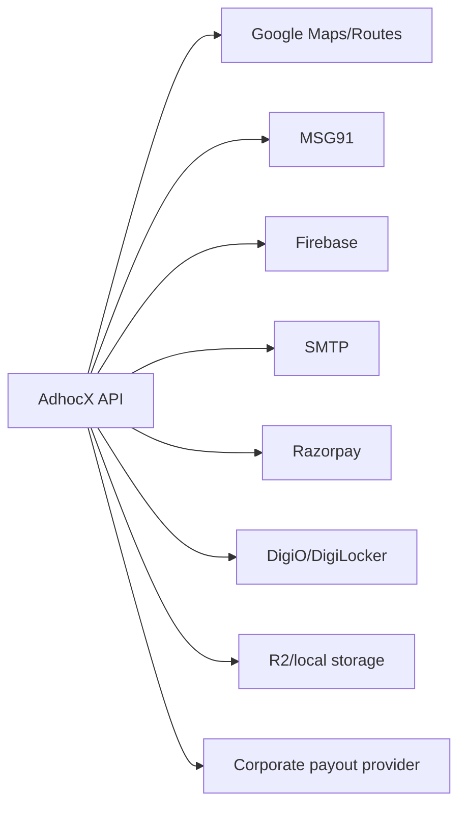

# External Integrations

**Evidence status:** Verified against API adapters and configuration modules.
Provider availability in a specific environment is environment-dependent.

For exact API service-to-provider wiring, adapter/port details and fallback
behavior, see the [API provider adapter reference](../../apps/api/provider-adapters.md).

## Integration Map

## Google Maps and Location

Google integration supports:

- geocoding
- road routing
- traffic-aware route matrix
- route direction
- travel-time matrix
- corporate route estimation

When no Maps key or route is available, some services use an offline
road-factor, Haversine or cached fallback. Pricing and dispatch code must
never label a fallback estimate as real road verification.

## Firebase

Firebase is used for push notifications and the mobile notification
experience. The API should treat Firebase delivery as an external side effect;
database notification state may exist independently of delivery success.

## MSG91

MSG91 sends SMS/OTP notifications. If the service is unconfigured or disabled,
the service can simulate delivery for controlled development/test behavior.
Test runs must not deliver real SMS unless explicitly configured and approved.

## SMTP

SMTP/Nodemailer provides email notifications where configured. Email delivery
must be retryable and audited without storing credentials in documentation.

## DigiO and DigiLocker

DigiO provides:

- PAN, DL and identity verification
- Vehicle RC and insurance data
- Aadhaar masking/liveness
- Bank/UPI and GST/business verification
- DigiLocker request workflows
- Admin verification suites

DigiO API calls use Basic authentication and configurable sandbox/production
base URLs. Webhooks require a configured checksum secret and use raw request
bytes for verification.

## Razorpay

Razorpay handles marketplace wallet and payment operations. A webhook is only
processed after signature verification. Provider events must not bypass
database ownership and idempotency checks.

## Corporate Payout Providers

The corporate payout domain depends on a provider port rather than one concrete
bank implementation.

- Development/test can use a mock provider
- Production fails closed if no provider is configured
- Submission is not paid state
- Paid state requires a signed provider confirmation
- Retries reuse the original idempotency key

## Object Storage

Storage selects R2/S3-compatible storage when configured and otherwise falls
back to local disk.

Uploads are:

- sanitized and MIME-checked
- saved with checksums
- optionally uploaded to R2
- exposed through signed/private upload paths where required

R2 failure falls back to local disk. Local disk is not a durable multi-instance
storage strategy and should not be treated as authoritative in production.
