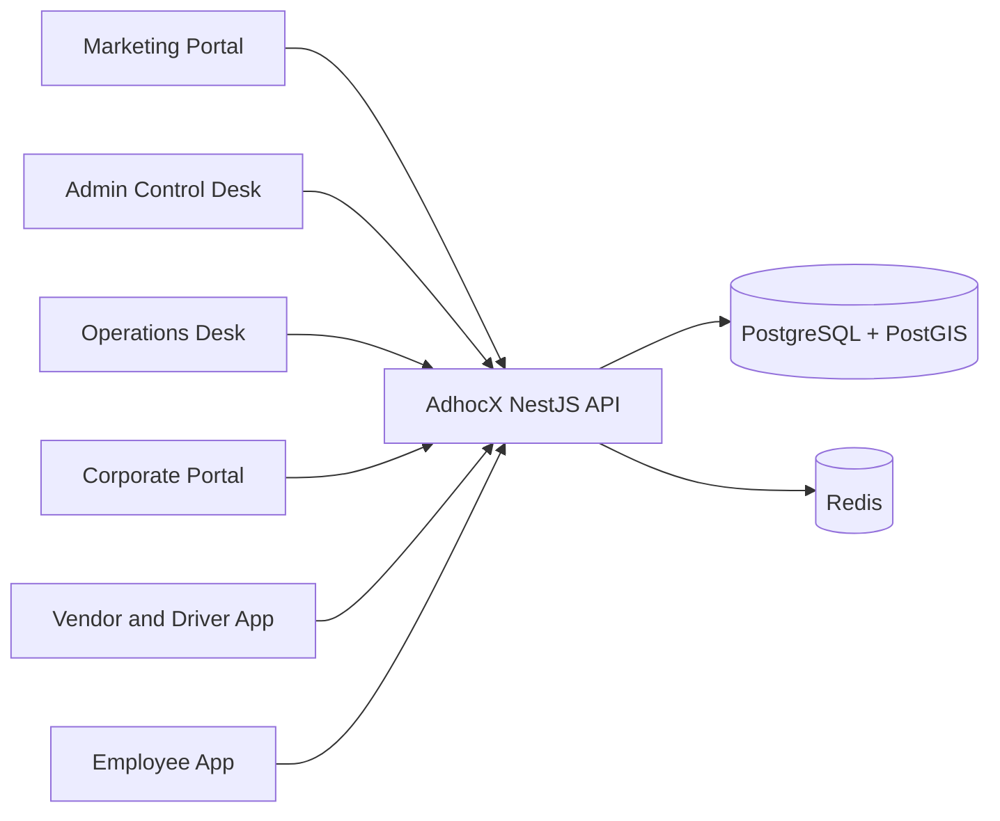

# AdhocX Project Overview

**Evidence status:** Verified where stated against repository source; product
specifications are identified separately from executable implementation.

## Purpose

AdhocX is a B2B commercial ground-mobility platform for vendor-to-driver
fulfillment and enterprise employee transportation.

The repository implements two connected mobility models:

1. **On-demand marketplace:** vendors post vehicle requirements, verified
   drivers receive offers and complete trips.
2. **Enterprise transportation (ETS):** corporate tenants publish rosters,
   generate routes, assign drivers and operate employee commute trips.

The two models share the same NestJS API, PostgreSQL database and Redis
infrastructure while retaining separate marketplace and corporate domain
services.

## Business Objectives

| Objective | Verified implementation evidence |
|---|---|
| Digitize cab sourcing | Requirement, offer and assignment modules |
| Dispatch verified commercial vehicles | Driver eligibility, vehicle, dispatch and trip modules |
| Operate corporate commute programs | Corporate tenant, roster, route, rider and scheduling modules |
| Maintain marketplace trip lifecycle | Requirements, offers, trips and trip-event models |
| Support real-time operations | Redis pub/sub, GPS telemetry, SSE tickets and operations APIs |
| Provide financial control | Payments, ledgers, settlements, invoices, disputes and payouts |
| Separate roles and tenant data | JWT authentication, RBAC guards and tenant context infrastructure |
| Provide compliance and support workflows | DigiO verification, audit logs, SOS and support-ticket modules |

## Project Scope

### Verified in repository

- Eight runnable application workspaces
- One modular NestJS backend
- PostgreSQL/PostGIS persistence
- Redis caching and pub/sub
- Next.js administration, operations and corporate clients
- Flutter vendor/driver and employee mobile clients
- Astro marketing portal
- Docusaurus documentation portal
- Docker and GitHub Actions deployment support
- Shared TypeScript contracts and domain-core packages

### Needs implementation confirmation

- Complete production parity for every route and feature specification
- Every external provider in every environment
- Every Flutter route against the live backend
- Corporate SSO provider integration
- Final public and internal documentation ownership

## Ecosystem Map

**ETS is a business domain, not a separate workspace.** Its verified
implementation spans the Corporate, Employee, Ops and Mobile applications and
corporate modules in `apps/api`.

## Application Inventory

| Application | Type | Primary actors | Implementation evidence |
|---|---|---|---|
| API | Backend monolith | Frontends and integration clients | `apps/api/src/app.module.ts` |
| Admin | Next.js frontend | Platform administrators | `apps/admin/src/app` |
| Ops | Next.js frontend | Operations and safety staff | `apps/ops/src/app` |
| Corporate | Next.js frontend | Corporate administrators and managers | `apps/corporate/src/app` |
| Mobile | Flutter frontend | Vendors and drivers | `apps/mobile/lib` |
| Employee App | Flutter frontend | Corporate commuters | `apps/employee_app/lib` |
| Marketing | Astro frontend | Prospects and public users | `apps/marketing/src/pages` |
| Documentation | Docusaurus frontend | Developers and operators | `apps/docs/docs` |

## Primary Capabilities

### Marketplace

- User, vendor and driver identity
- Vendor requirements and fulfillment
- Driver availability and KYC
- Geographic matching and dispatch
- Offers and trip assignment
- Trip execution and OTP workflow
- Pricing, wallet, ledger and settlements
- Reviews and dispute handling

### Corporate ETS

- Corporate tenant and office configuration
- Employee directory and rosters
- Route planning and optimization
- Shift templates and scheduling
- Corporate route offers and reassignment
- OTP/QR boarding and drop verification
- Live GPS telemetry and route playback
- SOS, incidents and support tickets
- Corporate invoices, disputes and driver payouts

## Users and Interfaces

| Role area | Primary application |
|---|---|
| Platform administration | Admin |
| Operations and safety | Ops |
| Corporate transport management | Corporate |
| Corporate employee | Employee App |
| Driver | Mobile |
| Marketplace vendor | Mobile |
| Public prospect or lead | Marketing |
| Developer or operator | Documentation |
