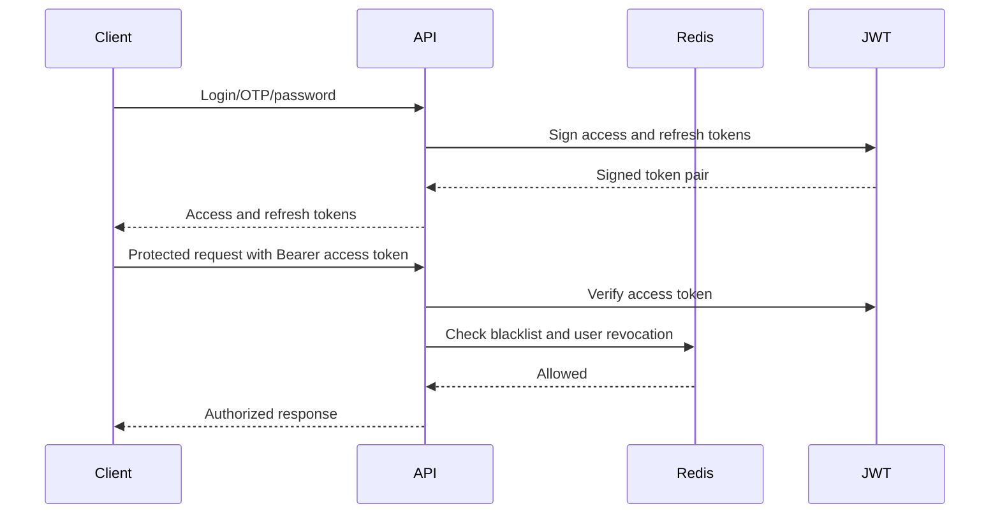

# Authentication and Sessions

**Evidence status:** Verified against authentication services, guards,
JWT configuration and Redis revocation code.

## Supported Authentication

The API supports:

- Password login
- OTP request and verification
- Social authentication
- Administrative login and MFA challenge
- Refresh-token exchange
- Password reset
- Account logout and deletion

The employee app supports password, OTP and company-email verification flows.
The mobile app includes OTP and password onboarding flows.

## OTP Security

OTP configuration is environment-driven:

- OTP expiry
- Resend delay
- Redis attempt limits
- Test OTP policy

Test OTP behavior must remain disabled in production unless independently
approved. Production environment code must not pick up repository test OTP
configuration.

The API attempts to invalidate OTP and reset keys after excessive attempts or
successful verification.

## JWT Access and Refresh Tokens

JWT signing secrets are resolved in `apps/api/src/config/auth.config.ts`.

Production rules:

- Access secret is required
- Refresh secret is required
- Published development secrets are rejected
- Secrets must meet minimum length requirements
- The API stops startup if production secrets are missing or weak

Access and refresh lifetimes are environment-configurable.

## Refresh

When an access token expires, clients can exchange the refresh token for a new
pair through the refresh endpoint.

Frontend behavior may:

- retry a failed 401 once after refresh
- queue concurrent requests during a refresh
- clear local session if refresh fails

The server remains responsible for checking revoked and suspended sessions.

## Revocation

The API can revoke:

- one access token using a token hash
- all sessions for a user

Revocation state is checked through Redis. User account suspension or password
change can invalidate issued sessions.

Live-stream access uses single-use tickets instead of an access token in the
URL. Tickets are consumed once and expire after a short window.
