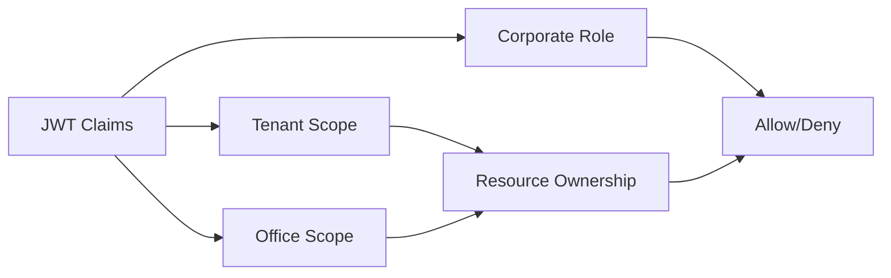

# RBAC and Tenant Security

**Evidence status:** Verified against `RolesGuard`,
`CorporateAccessGuard`, corporate permission modules and decorators.

## Platform Roles

The primary JWT roles are:

- `VENDOR`
- `DRIVER`
- `ADMIN`
- `OPS`
- `CORPORATE_ADMIN`
- `CORPORATE_MANAGER`
- `EMPLOYEE`

`RolesGuard`:

- reads required roles from route metadata
- normalizes aliases
- grants unrestricted access to `ADMIN`
- rejects users whose role is missing or disallowed

## Corporate Roles

Fine-grained corporate roles are stored on corporate users:

| Role | Scope |
|---|---|
| `CORP_SUPER_ADMIN` | Full tenant administration |
| `HR` | Employee and people administration |
| `TRANSPORT` | Offices, employees, zones and bookings |
| `FINANCE` | Cost centers, invoices and billing |
| `SAFETY` | Safety and tenant visibility |
| `READ_ONLY` | Read-only tenant access |

Legacy corporate users are mapped:

- `CORPORATE_ADMIN` → `CORP_SUPER_ADMIN`
- `CORPORATE_MANAGER` → `TRANSPORT`

Unknown explicit corporate roles resolve to `READ_ONLY` rather than a
privileged role.

## Corporate Permission Matrix

The corporate permission model uses capabilities such as:

- `tenant:read` / `tenant:write`
- `offices:read` / `offices:write`
- `employees:read` / `employees:write`
- `users:read` / `users:invite`
- `departments:*`
- `zones:*`
- `costcenters:*`
- `policy:*`
- `invoices:read`
- `bookings:read`
- `billing:write`
- `reports:read`

A handler may declare `@CorporatePermission(...)`; the corporate guard rejects
callers without that permission.

## Tenant Isolation

Tenant-scoped corporate handlers:

- read the tenant ID from the JWT claim
- reject client-supplied tenant mismatch
- force query/body tenant data to the caller's tenant
- reject inactive or missing tenants

## Office Scope

Corporate users may carry a list of office IDs. A non-empty list limits the
caller to those offices. Empty scope means all offices for the tenant.

Office scope is checked for:

- tenant-scoped office parameters
- routes, rosters and employees
- resource-specific office ownership

## Resource Ownership

`CorporateAccessGuard` supports resource declarations for:

- Tenant
- Office
- Employee
- Roster
- Route
- Route stop
- Transport request
- Invoice
- SOS alert
- Support ticket
- Driver

The guard:

- loads a minimal resource projection
- returns 404 for missing resources
- compares tenant and office scope
- verifies employee, driver or assigned-route ownership
- supports offer-specific driver ownership for route offers

## Authorization Rule

Frontend role checks, route hiding and button disabling are presentation
controls. Only the NestJS guards and services provide server authorization.
