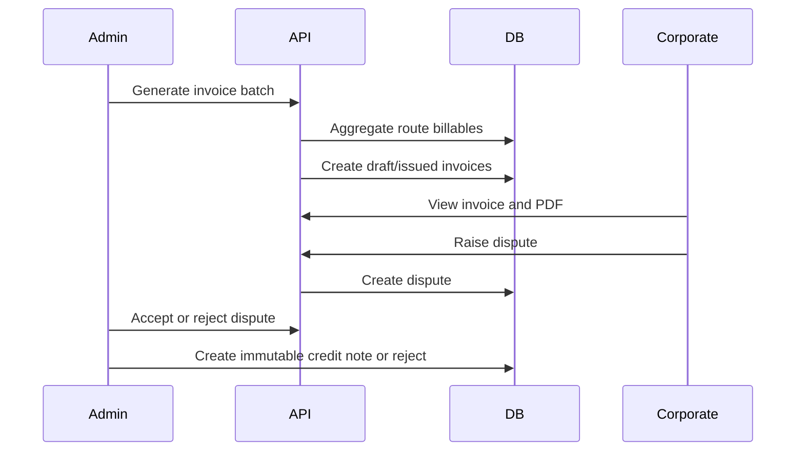
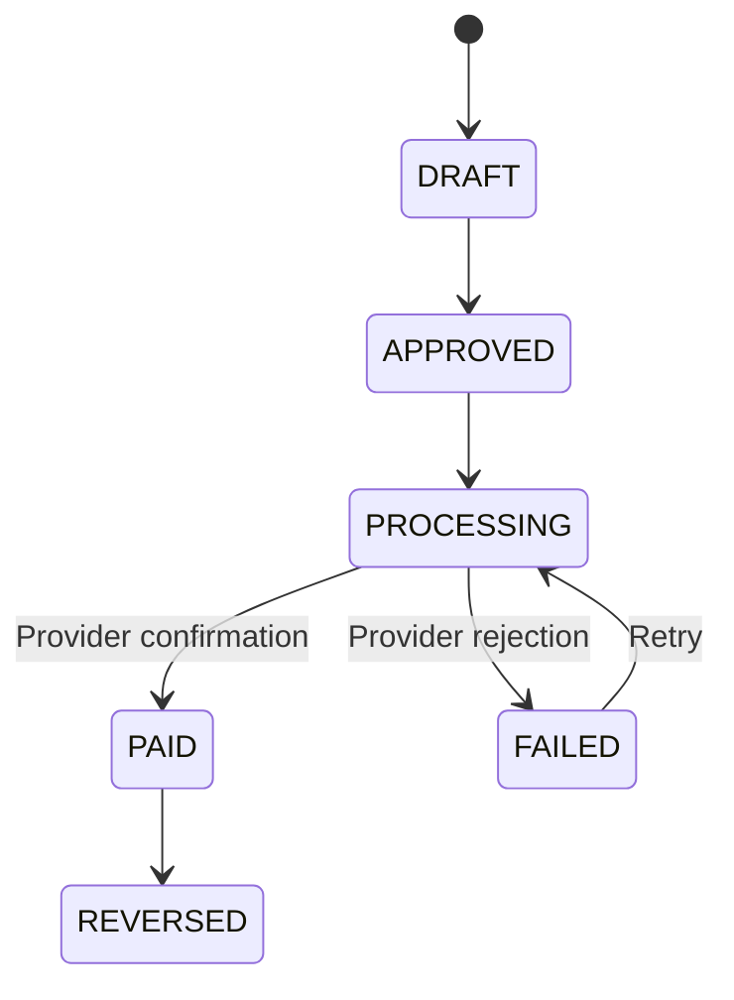

# Billing and Payout Workflow

**Evidence status:** Verified against corporate billing and payout services.

## Invoice Workflow

Invoices use paise values rather than frontend floating-point values for
corporate and GST calculations.

Issued invoices are not edited. Corrections use disputes and credit notes.

## Payout Workflow

Payout invariants:

- A payout batch has maker/checker separation.
- A checker cannot approve their own batch.
- Submission sends the batch to the provider.
- Submission never itself marks the payout paid.
- Provider callback confirmation performs the paid transition.
- Reversal creates compensating records.
- Reconciliation identifies mismatches and unmatched confirmations.
