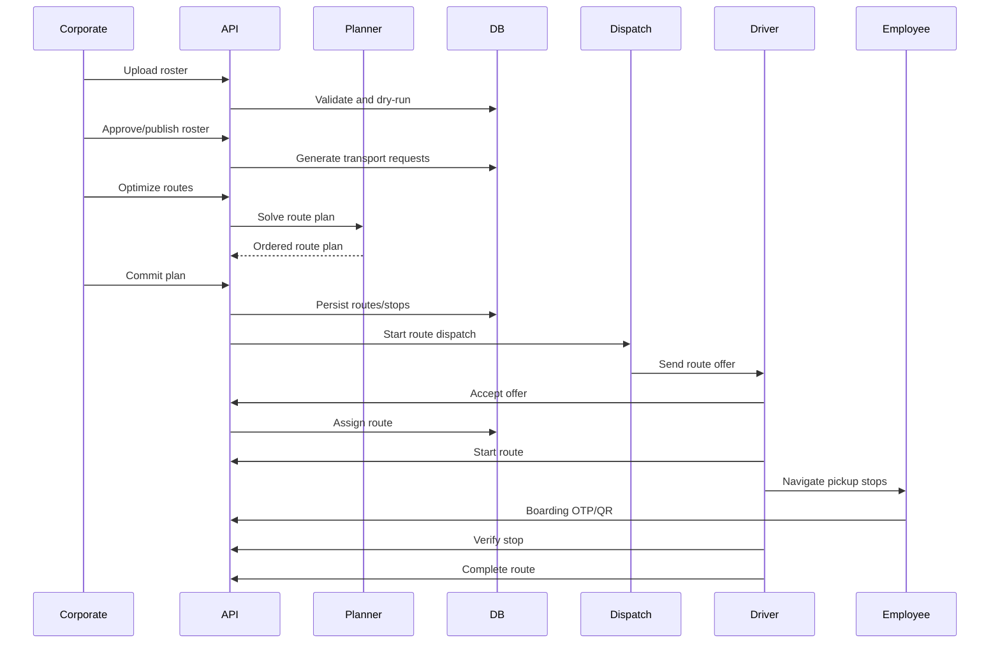
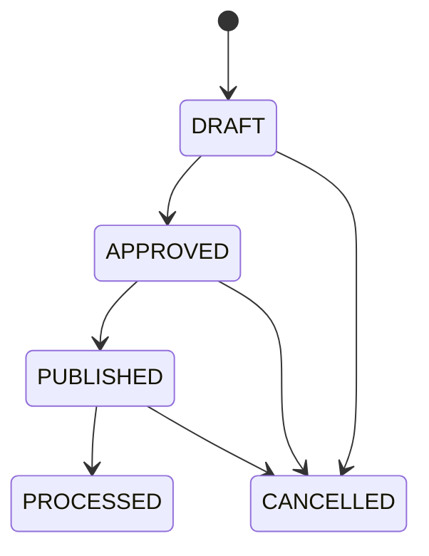

# ETS Roster to Route

**Evidence status:** Verified across roster, route, dispatch and trip execution
controllers/services.

## Happy Path

## Roster Lifecycle

Upload mode determines whether a roster is created as draft or published
directly. Publishing uses idempotent transport-request generation.

## Route States

Verified route states include:

- `PLANNED`
- `DISPATCHING`
- `ASSIGNED`
- `IN_TRANSIT`
- `COMPLETED`
- `CANCELLED`

The route execution service requires:

- Driver verification
- Vehicle capacity vs passenger count
- Assigned route ownership
- Arrival coordinates
- Boarding OTP/QR validity
- Stop and route state

## Stop and Safety States

Corporate stops use lifecycle states including pending, arrived, boarded,
no-show and cancelled. A stop may have:

- 5-minute dwell buffer
- OTP attempt limits
- Dynamic QR token
- Arrival/drop geofence checks
- Safe-reach confirmation
