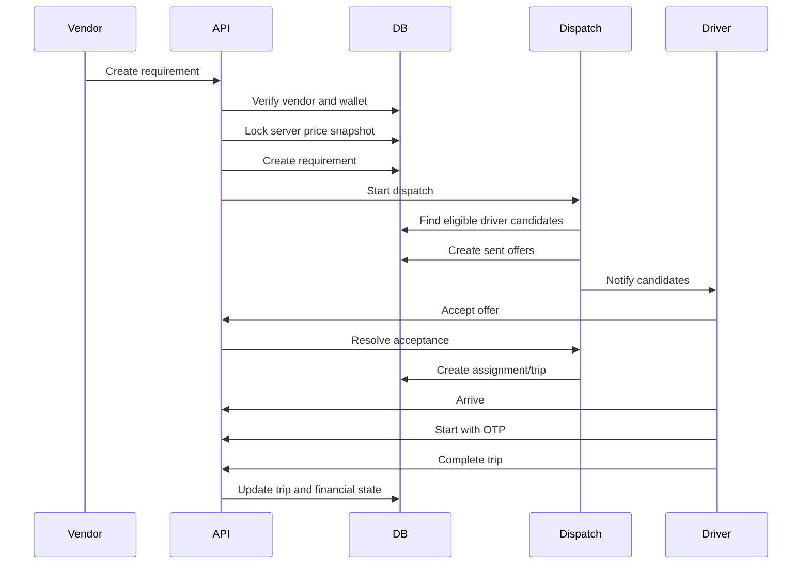
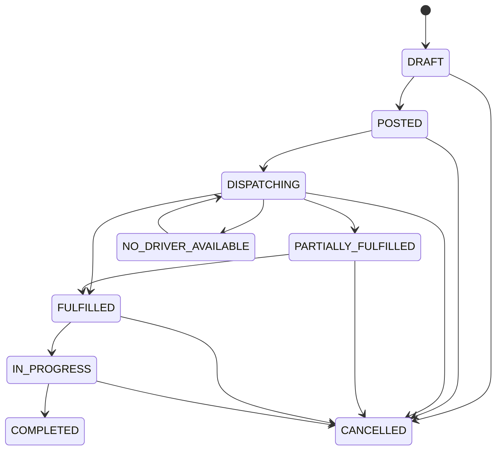

# Marketplace Requirement to Trip

**Evidence status:** Verified against requirement, dispatch, offer, trip and
shared state-machine source.

## Happy Path

## Guards

Before requirement creation, the API:

- verifies the vendor profile
- verifies vendor verification status
- checks pending review
- resolves the server-authoritative quote/snapshot
- validates wallet sufficiency
- creates a priced requirement

Before dispatch, the API searches eligible drivers and creates offer waves.

Before offer acceptance, the offer must:

- belong to the authenticated driver
- remain in `SENT`
- remain unexpired
- satisfy requirement capacity
- satisfy current driver/vehicle eligibility

Before trip start, the server verifies:

- assigned driver ownership
- OTP
- current trip state
- required operational preconditions

## State Flow

Cancellation and no-progress states are terminal only where the shared
state validator declares them terminal.
