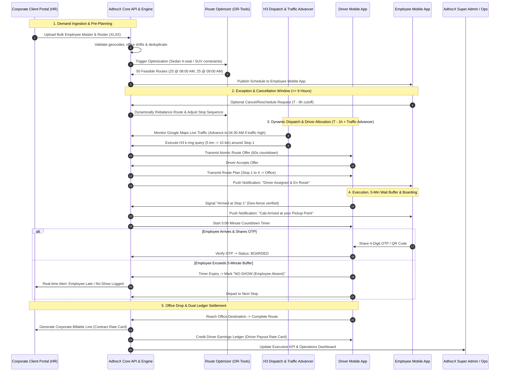

# 00 — MASTER PLAN: ADHOCX CORPORATE EMPLOYEE TRANSPORTATION SYSTEM (ETS)

**Product:** AdhocX Direct Corporate Managed Transport  
**Document:** Master Plan & Strategic Specification  
**Status:** Source of Truth Baseline  
**Version:** 2.0 (Hyderabad Enterprise ETS Pilot)  
**Company:** Estemporaneo Technologies Private Limited  
**Target Pilot:** 90-Day Enterprise MVP  

---

> ### ⚠️ MANDATORY DESIGN & IMPLEMENTATION DIRECTIVE FOR ALL AI AGENTS & ENGINEERS
> Every AI agent, prompt, developer, and automated assistant modifying or contributing to this codebase **MUST STRICTLY ADHERE** to the project's foundational guidelines:
> 1. **Visual Foundation:** [`docs/04_DESIGN_SYSTEM.md`](file:///c:/Users/saavi/Desktop/adhocx/docs/04_DESIGN_SYSTEM.md) (Colors, Typography, Spacing, Tokens, Radius, Component Styling)
> 2. **Interaction & User Journey Rules:** [`docs/05_UI_UX_GUIDELINES.md`](file:///c:/Users/saavi/Desktop/adhocx/docs/05_UI_UX_GUIDELINES.md) (Information Architecture, Screen States, Error Handling, Navigation)
> 3. **Engineering Authority & Constraints:** [`docs/20_AI_AGENT_RULES.md`](file:///c:/Users/saavi/Desktop/adhocx/docs/20_AI_AGENT_RULES.md) (Correctness > Architecture > Security > Speed. Zero hallucinated business rules. Preserved integrity).
>
> **Under no circumstances should any developer or agent reinvent styles, bypass state machines, or invent unsanctioned shortcuts.**

---

# 1. Executive Summary & PRD Reconciliation

## 1.1 Alignment Analysis: User Model vs. Working PRD v2.0
The operational model described by AdhocX leadership matches the core architectural foundation established in the **AdhocX Employee Transportation System Complete PRD v1.0**, **Corporate Client Portal PRD v2.0**, **AdhocX Super Admin PRD v2.0**, and **Employee & Driver Mobile App PRD v2.0**.

| Dimension | User Model Requirements | PRD v2.0 Alignment & Specification | Operational Verification |
| :--- | :--- | :--- | :--- |
| **Enterprise Business Model** | Direct B2B contract with Company X; AdhocX operates transport directly with independent driver-owned cabs. No vendor intermediary in this product. | **PRD Section 1 & 2:** "Enterprise business model: corporate clients contract directly with AdhocX. AdhocX plans and operates transportation through independently onboarded drivers using eligible driver-owned cabs. No vendor intermediary exists in this product." | **100% Aligned.** Complete decoupling from legacy marketplace vendor brokerages. |
| **Roster Ingestion** | Company X uploads structured Excel sheet with 500 employees (home locations, login/logout times, shifts, departments). System operates 100% autonomously without human intervention. | **PRD Section 3.3, 5.2, 5.3 (COR-03-02, CP-ROS-02):** Bulk XLSX/CSV import engine with dry-run validation, automated geocoding, duplicate prevention, and idempotent demand generation. | **100% Aligned.** Automatic trigger of optimization jobs upon approved roster publishing. |
| **Vehicle Capacity & Fleet Sizing** | Sedans strictly capped at 4 employees per cab; SUVs used where required. 500 employees / 4 = 120-125 cab requirements batched across shifts. | **PRD Section 4 & 10.2 (RTE-02):** "An assigned vehicle cannot exceed licensed/configured seating capacity. Solve capacitated vehicle routing with pickup windows, max ride time and hard constraints." | **100% Aligned.** Enforces strict 4-seat sedan and 6-seat SUV allocation algorithms. |
| **Shift Clustering & Batches** | 2 Login shifts (8:00 AM, 9:00 AM) and 2 Logout shifts (5:00 PM, 6:00 PM). E.g., 50 routes split into 25 cabs at 8 AM and 25 cabs at 9 AM. | **PRD Section 3.4 & 10.2 (RTE-01):** Shift templates, rotating schedules, clustering employees by pickup/drop direction, time window, and destination office. | **100% Aligned.** Batch routing engine segments demand per shift template and time envelope. |
| **Route Time & Stop Buffer Math** | Travel time from 1st stop to office: 1.5 hrs. Buffer per pickup stop: 5 minutes. 4 stops * 5 min = 20 min. Total trip duration = 1 hr 50 min (~2 hrs). For 8:00 AM login, cab must reach 1st stop at 6:00 AM. | **PRD Section 10.1 & 10.2:** Travel-time/distance matrix, estimated traffic, pickup windows, stop dwell times, and maximum employee ride duration. | **100% Aligned.** Dwell time parameter default set to exactly 5.0 minutes per pickup node. |
| **Autonomous Dispatch & H3 Grid** | Dispatch search starts 1 hour before 1st pickup (e.g. 5:00 AM for 6:00 AM pickup). Searches 5 km radius, expanding up to 10 km. Utilizes H3 hexagonal spatial indexing. | **PRD Section 10.3 (ALLOC-01 to ALLOC-04):** Filter eligible online drivers, rank by ETA, send time-limited atomic offers. H3 indexing engine calculates k-ring expansion. | **100% Aligned.** PostGIS + Uber H3 resolution 8/9 k-ring radius search (5 km step to 10 km cap). |
| **Dynamic Traffic Advancer** | Integrated Google Maps Traffic Matrix. If heavy congestion is detected on the route, system dynamically shifts dispatch earlier (e.g., 4:00 AM or 4:30 AM). | **PRD Section 10.1 & 14:** Travel-time/distance matrix with real-time traffic inputs and automated dispatch lead-time adjustments. | **100% Aligned.** Dynamic Dispatch Advancer (DDA) daemon continuously recalculates route ETA. |
| **Boarding Verification & 5-Min Timer** | Driver arrives; employee mobile app receives notification. OTP/QR code exchanged for boarding. Driver waits up to 5 min buffer; if employee doesn't show, marked as "No-Show". | **PRD Section 3.6, 7.3, 10.4 (EMP-06-01, DRV-10):** Expiring OTP challenge bound to trip and employee. 5-min dwell timer triggers audited passenger no-show state. | **100% Aligned.** Synchronized countdown timer in driver app with GPS geo-fence validation. |
| **Logout (Evening Drop) Flow** | Logout at 6:00 PM: Dispatch begins at 5:00 PM. Cab must be at office 15 minutes before shift (5:45 PM). Driver searched within 10 km of corporate office. | **PRD Section 3.5, 6, 7.3:** Reverse route optimization (office origin -> multi-stop residential drops) with 15-minute staging buffer before shift end. | **100% Aligned.** Origin hub staging with driver check-in at corporate transport bay. |
| **Reschedule & Cancellation Engine** | Employee cancellation up to 9 hours before pickup time. Rescheduling shifts (e.g. 7 AM to 9 AM) triggers automated dynamic route re-optimization. | **PRD Section 3.3, 3.5, 6.2 (EMP-03-02, FLOW-04):** Configurable cut-off policies (9-hour default), approval-free self-service before cutoff, dynamic route rebalancing. | **100% Aligned.** Subsystem de-allocates passenger, recalculates route stops, and updates driver navigation. |
| **Corporate Portal Transparency** | Corporate HR/Transport dashboard displays real-time employee attendance, trip execution, late arrivals, and no-shows with audit proof. | **PRD Corporate Portal (COR-02-01 to COR-02-03, CP-DASH-01):** Real-time drill-down into source trips, punctuality metrics, seat utilization, and driver location. | **100% Aligned.** Complete transparency without exposing internal driver pay rates. |
| **Trips & Ride Management (Admin)** | Super Admin panel includes dedicated "Trips and Ride Management Panel" with manual dispatch override ("Start" button) and compliance verification. | **PRD Super Admin (ADH-04-01 to ADH-04-03, OPS-02):** Operational overview, exception queue, unassigned route dispatching, and audited manual overrides. | **100% Aligned.** Interactive operational board for manual and automated dispatch triggers. |

---

# 2. End-to-End Operational Workflow Architecture

The following sequence illustrates the complete operational lifecycle from employee master upload to night-time financial settlement:

---

# 3. Mathematical Equations & Operational Formulas

### Formula 1: Total Route Trip Duration ($T_{\text{route}}$)
$$T_{\text{route}} = T_{\text{drive}} + \sum_{i=1}^{N_{\text{stops}}} T_{\text{dwell}}(i)$$
Where:
- $T_{\text{drive}}$ = Dynamic estimated driving time via Google Maps Matrix API with live traffic (e.g., 90 minutes).
- $N_{\text{stops}}$ = Number of employee residential pickup stops (standard sedan $N = 4$).
- $T_{\text{dwell}}$ = Buffer waiting time per stop (fixed at **5.0 minutes**).
- **Example Calculation:**
  $$T_{\text{route}} = 90\text{ min} + (4 \times 5\text{ min}) = 90 + 20 = 110\text{ min (1 hour 50 minutes)} \approx 2\text{ hours}$$

### Formula 2: Target Arrival Time at Stop 1 ($t_{\text{pickup\_1}}$)
$$t_{\text{pickup\_1}} = t_{\text{shift\_login}} - T_{\text{route}}$$
- For Shift Login at **08:00 AM**:
  $$t_{\text{pickup\_1}} = 08:00\text{ AM} - 01:50 = 06:10\text{ AM (Target: 06:00 AM to 06:10 AM)}$$

### Formula 3: Dynamic Dispatch Lead Time ($t_{\text{dispatch}}$)
$$t_{\text{dispatch}} = t_{\text{pickup\_1}} - \Delta t_{\text{lead}} - \Delta t_{\text{traffic\_delay}}$$
Where:
- $\Delta t_{\text{lead}}$ = Standard dispatch lead time (**60 minutes** before first pickup).
- $\Delta t_{\text{traffic\_delay}}$ = Incremental delay identified from Google Maps Live Traffic API.
- **Normal Flow:**
  $$t_{\text{dispatch}} = 06:00\text{ AM} - 60\text{ min} = 05:00\text{ AM}$$
- **Heavy Traffic Flow ($\Delta t_{\text{traffic}} = 60\text{ min}$):**
  $$t_{\text{dispatch}} = 06:00\text{ AM} - 60\text{ min} - 60\text{ min} = 04:00\text{ AM}$$

### Formula 4: Evening Logout Office Staging Time ($t_{\text{office\_staging}}$)
$$t_{\text{office\_staging}} = t_{\text{shift\_logout}} - 15\text{ min}$$
- For Shift Logout at **06:00 PM**:
  $$t_{\text{office\_staging}} = 06:00\text{ PM} - 15\text{ min} = 05:45\text{ PM}$$
- Dispatch search initiated at:
  $$t_{\text{dispatch\_logout}} = t_{\text{shift\_logout}} - 60\text{ min} = 05:00\text{ PM}$$

---

# 4. System Ecosystem & Inventory of Detailed Documentation

To ensure engineering rigor and full architectural clarity for all AI coding agents and developers, the AdhocX Corporate ETS documentation is organized into **15 authoritative documents**:

| Doc Index | Document Title & Path | Primary Objective & Scope |
| :---: | :--- | :--- |
| **01** | [`01_TECHNICAL_ARCHITECTURE_AND_SYSTEM_DESIGN.md`](file:///c:/Users/saavi/Desktop/adhocx/docs/corporate-ets/01_TECHNICAL_ARCHITECTURE_AND_SYSTEM_DESIGN.md) | High-level system architecture, NestJS micro-modules, Flutter mobile clients, Next.js web applications, Redis pub/sub, PostGIS geometry, and infrastructure topology. |
| **02** | [`02_ROSTER_INGESTION_AND_EXCEL_IMPORT_ENGINE.md`](file:///c:/Users/saavi/Desktop/adhocx/docs/corporate-ets/02_ROSTER_INGESTION_AND_EXCEL_IMPORT_ENGINE.md) | Standard XLSX/CSV data format, dry-run schema validation, duplicate detection, address geocoding, error reporting, and idempotent demand generation. |
| **03** | [`03_ROUTE_OPTIMIZATION_AND_CAPACITY_SOLVER.md`](file:///c:/Users/saavi/Desktop/adhocx/docs/corporate-ets/03_ROUTE_OPTIMIZATION_AND_CAPACITY_SOLVER.md) | Capacitated Vehicle Routing Problem (CVRP) with Time Windows (VRPTW), Google OR-Tools integration, Sedan (4-passenger) vs SUV constraints, and clustering. |
| **04** | [`04_AUTONOMOUS_DISPATCH_AND_H3_ROUTING_ENGINE.md`](file:///c:/Users/saavi/Desktop/adhocx/docs/corporate-ets/04_AUTONOMOUS_DISPATCH_AND_H3_ROUTING_ENGINE.md) | Autonomous dispatch lifecycle, Uber H3 hexagonal spatial indexing, radial expansion (5 km to 10 km), Google Maps dynamic traffic advancer, and atomic offer resolution. |
| **05** | [`05_TRIP_EXECUTION_OTP_AND_5MIN_NO_SHOW_LIFECYCLE.md`](file:///c:/Users/saavi/Desktop/adhocx/docs/corporate-ets/05_TRIP_EXECUTION_OTP_AND_5MIN_NO_SHOW_LIFECYCLE.md) | Step-by-step trip execution state machine, geo-fenced arrival, 5-minute stop countdown timer, OTP/QR boarding verification, and automated "No-Show" logging. |
| **06** | [`06_RESCHEDULE_AND_CANCELLATION_ENGINE.md`](file:///c:/Users/saavi/Desktop/adhocx/docs/corporate-ets/06_RESCHEDULE_AND_CANCELLATION_ENGINE.md) | 9-hour employee cancellation cutoff rule, shift rescheduling, automated dynamic route re-balancing, passenger de-allocation, and driver notification. |
| **07** | [`07_CORPORATE_CLIENT_PORTAL_SPECIFICATION.md`](file:///c:/Users/saavi/Desktop/adhocx/docs/corporate-ets/07_CORPORATE_CLIENT_PORTAL_SPECIFICATION.md) | Next.js Corporate Portal (22 screens), RBAC (HR, Transport, Finance, Safety), real-time employee attendance tracking, route tracking, and invoices. |
| **08** | [`08_EMPLOYEE_MOBILE_APP_SPECIFICATION.md`](file:///c:/Users/saavi/Desktop/adhocx/docs/corporate-ets/08_EMPLOYEE_MOBILE_APP_SPECIFICATION.md) | Flutter Employee App (23 screens), roster schedule view, assigned cab & driver display, live map with GPS freshness, boarding OTP, push notifications, and SOS. |
| **09** | [`09_DRIVER_MOBILE_APP_SPECIFICATION.md`](file:///c:/Users/saavi/Desktop/adhocx/docs/corporate-ets/09_DRIVER_MOBILE_APP_SPECIFICATION.md) | Flutter Driver App (23 screens), direct onboarding without vendor intermediary, vehicle RC/permit compliance, atomic offers, turn-by-turn routing, and earnings. |
| **10** | [`10_SUPER_ADMIN_AND_TRIPS_RIDE_MANAGEMENT_PANEL.md`](file:///c:/Users/saavi/Desktop/adhocx/docs/corporate-ets/10_SUPER_ADMIN_AND_TRIPS_RIDE_MANAGEMENT_PANEL.md) | Super Admin Portal (24 screens), compliance review desk, dedicated "Trips and Ride Management Panel", and manual route dispatch override ("Start" button). |
| **11** | [`11_SAFETY_SOS_AND_COMMAND_CENTRE_OPERATIONS.md`](file:///c:/Users/saavi/Desktop/adhocx/docs/corporate-ets/11_SAFETY_SOS_AND_COMMAND_CENTRE_OPERATIONS.md) | 24x7 Command Centre console, SOS emergency trigger, overspeed & prolonged stop alerts, route deviation detection, stale GPS rules, and emergency runbooks. |
| **12** | [`12_REALTIME_GPS_TRACKING_AND_NOTIFICATIONS.md`](file:///c:/Users/saavi/Desktop/adhocx/docs/corporate-ets/12_REALTIME_GPS_TRACKING_AND_NOTIFICATIONS.md) | WebSocket & Server-Sent Events architecture, Redis pub/sub, GPS throttle (15-30s), stale status detection, and multi-channel notification engine (FCM/SMS). |
| **13** | [`13_DUAL_FINANCIAL_LEDGERS_BILLING_AND_PAYOUTS.md`](file:///c:/Users/saavi/Desktop/adhocx/docs/corporate-ets/13_DUAL_FINANCIAL_LEDGERS_BILLING_AND_PAYOUTS.md) | Strict isolation of Corporate Contract Billing Rate Cards vs Driver Payout Rate Cards, GST invoicing, automated driver payout batches, and bank reconciliation. |
| **14** | [`14_DATABASE_SCHEMA_POSTGIS_AND_DATA_CONTRACTS.md`](file:///c:/Users/saavi/Desktop/adhocx/docs/corporate-ets/14_DATABASE_SCHEMA_POSTGIS_AND_DATA_CONTRACTS.md) | Complete PostgreSQL + PostGIS DDL, multi-tenant row-level security (RLS), spatial indexes, partitioned tracking tables, and data dictionary. |
| **15** | [`15_API_INVENTORY_EVENT_CONTRACTS_AND_STATE_MACHINES.md`](file:///c:/Users/saavi/Desktop/adhocx/docs/corporate-ets/15_API_INVENTORY_EVENT_CONTRACTS_AND_STATE_MACHINES.md) | Comprehensive REST API inventory (v1), JSON Schema definitions, Webhook event payloads, and exhaustive finite state machines for all core entities. |

---

# 5. Core Architectural Decisions (ADRs)

1. **ADR-ETS-01: Direct Cab-Owning Driver Relationship (No Vendor Brokerage)**  
   *Decision:* The corporate ETS system completely removes vendor intermediaries. Drivers sign agreements directly with AdhocX and must own or have verified legal authorization for their commercial vehicle.  
   *Rationale:* Eliminates margin leakage, enforces direct safety and document compliance, and prevents subcontracting risks.

2. **ADR-ETS-02: Spatial Indexing via Uber H3 Hexagonal Grid**  
   *Decision:* Driver proximity and geo-spatial queries use Uber H3 indexes (`h3-js` / PostGIS H3 extension) at resolution 8 (~460m hex edge) and 9 (~174m hex edge) rather than raw Euclidean distance computations.  
   *Rationale:* Sub-millisecond $k$-ring queries, constant-time geospatial clustering, and uniform cell coverage without pole distortion.

3. **ADR-ETS-03: Two-Tier Ledger Financial Architecture**  
   *Decision:* Complete separation between `corporate_billable_ledger` (client invoices) and `driver_payout_ledger` (driver compensation).  
   *Rationale:* Client organizations must never have visibility into internal driver payout rates or platform margins. Every completed route generates two independent, immutable ledger entries linked by `trip_id`.

4. **ADR-ETS-04: Deterministic OR-Tools Vehicle Routing Before Predictive AI**  
   *Decision:* V1 utilizes deterministic mathematical optimization (Google OR-Tools VRPTW) for vehicle routing.  
   *Rationale:* Predictability, auditability, and guaranteed constraint satisfaction (strict seat limits, max travel time) are mandatory for corporate enterprise SLAs.

---

# 6. Pilot Governance & Success Metrics (Hyderabad 90-Day MVP)

| Metric | Target Goal | Measurement Mechanism |
| :--- | :--- | :--- |
| **On-Time Office Arrival** | $\ge 98.5\%$ | GPS timestamp of vehicle arrival at corporate office $\le$ shift login time. |
| **Automated Dispatch Fulfillment** | $\ge 99.0\%$ | Routes assigned to verified drivers without manual dispatcher intervention. |
| **Pickup Window Punctuality** | $\ge 95.0\%$ | Driver arrives within $[-5\text{ min}, +5\text{ min}]$ of scheduled stop pickup time. |
| **No-Show Audit Accuracy** | $100\%$ | Geofence verified + 5:00 minute wait timer elapsed prior to driver departure. |
| **SOS Acknowledgment Time** | $< 30\text{ seconds}$ | Command Centre operator acknowledgement timestamp from SOS trigger event. |
| **Billing & Payout Reconciliation** | $0\text{ Discrepancy}$ | 100% automated match between completed trip logs and dual ledger entries. |

---
*Proceed to individual detailed specification documents (01 through 15) for complete implementation requirements.*

