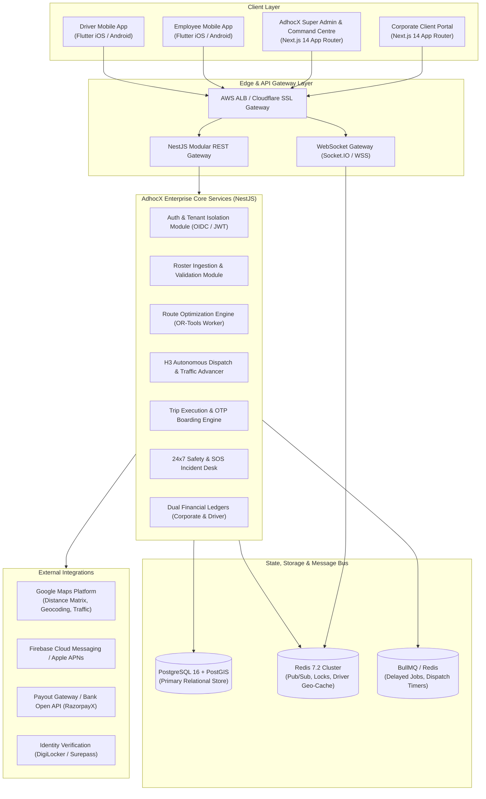

# 01 — TECHNICAL ARCHITECTURE & SYSTEM DESIGN

**Product:** AdhocX Direct Corporate Managed Transport (ETS)  
**Document:** Technical Architecture & System Design Specification  
**Status:** Source of Truth Baseline  
**Version:** 2.0 (Hyderabad Enterprise ETS Pilot)  
**Company:** Estemporaneo Technologies Private Limited  

---

> ### ⚠️ MANDATORY DESIGN & IMPLEMENTATION DIRECTIVE FOR ALL AI AGENTS & ENGINEERS
> Every AI agent, prompt, developer, and automated assistant modifying or contributing to this codebase **MUST STRICTLY ADHERE** to the project's foundational guidelines:
> 1. **Visual Foundation:** [`docs/04_DESIGN_SYSTEM.md`](file:///c:/Users/saavi/Desktop/adhocx/docs/04_DESIGN_SYSTEM.md) (Colors, Typography, Spacing, Tokens, Radius, Component Styling)
> 2. **Interaction & User Journey Rules:** [`docs/05_UI_UX_GUIDELINES.md`](file:///c:/Users/saavi/Desktop/adhocx/docs/05_UI_UX_GUIDELINES.md) (Information Architecture, Screen States, Error Handling, Navigation)
> 3. **Engineering Authority & Constraints:** [`docs/20_AI_AGENT_RULES.md`](file:///c:/Users/saavi/Desktop/adhocx/docs/20_AI_AGENT_RULES.md) (Correctness > Architecture > Security > Speed. Zero hallucinated business rules. Preserved integrity).

---

# 1. Architectural Overview & Topology

AdhocX ETS is engineered as a high-throughput, event-driven, multi-tenant enterprise mobility platform. It decouples high-volume real-time ingestion (GPS pings, WebSocket events) from transactional business domain logic (roster validation, billing, compliance auditing, driver offers).



---

# 2. Technology Stack Standards

| Tier | Technology | Justification & Architecture Role |
| :--- | :--- | :--- |
| **Backend Framework** | **NestJS (TypeScript)** | Enterprise modularity, strict dependency injection, built-in validation pipes (`class-validator`), OpenAPI swagger generation. |
| **Mobile Platforms** | **Flutter (Dart 3.x)** | Cross-platform single codebase for iOS and Android, 60fps render engine, background location services, battery-efficient SQLite offline caching. |
| **Web Applications** | **Next.js 14 (React, TypeScript)** | Server-side rendering (SSR), TailwindCSS, TanStack Table, Leaflet/Mapbox GL live operations maps, strict responsive design. |
| **Primary Database** | **PostgreSQL 16 + PostGIS** | Spatial indexing (`ST_DWithin`, `ST_Point`), multi-tenant schema isolation, row-level security (RLS), ACID transactions. |
| **Spatial Indexing** | **Uber H3 (`h3-js` / PostGIS H3)** | Hexagonal hierarchical spatial indexing (Resolution 8 & 9) for rapid driver proximity searches and k-ring radial queries. |
| **In-Memory & Queues** | **Redis 7.2 & BullMQ** | Sub-millisecond distributed locking (Redlock), driver geospatial caching (`GEOADD`), delayed dispatch jobs, and WebSocket pub/sub. |
| **Optimization Solver**| **Google OR-Tools (Python/C++ Wrapper)** | Deterministic Capacitated Vehicle Routing Problem with Time Windows (CVRPTW). |
| **Maps & Routing** | **Google Maps Platform** | Directions API, Distance Matrix API with live predictive traffic, Roads API for snap-to-road tracking. |
| **Realtime Transport** | **WebSockets (Socket.IO)** | Real-time driver tracking, arrival alerts, countdown timers, and SOS incident broadcasting. |

---

# 3. Monorepo Workspace Structure

The project leverages a high-performance **pnpm + Turborepo** monorepo layout:

```text
adhocx/
├── apps/
│   ├── admin/               # Next.js 14 AdhocX Super Admin & Command Centre
│   ├── corporate/           # Next.js 14 Corporate Client Portal
│   ├── api/                 # NestJS Core Enterprise Backend
│   └── mobile/              # Flutter Workspace (Driver App & Employee App targets)
├── packages/
│   ├── contracts/           # Shared TypeScript DTOs, Enums, Zod Schemas & State Machines
│   ├── config/              # Shared Tailwind, ESLint, TypeScript & Prettier configurations
│   └── h3-routing/          # H3 Spatial Indexing and Route Matrix algorithms
├── docs/
│   ├── 04_DESIGN_SYSTEM.md  # Core Visual Tokens & Theme
│   ├── 05_UI_UX_GUIDELINES.md # Interaction Principles
│   ├── 20_AI_AGENT_RULES.md # Coding & Architecture Safeguards
│   └── corporate-ets/       # Authoritative Corporate ETS Specification Suite
```

---

# 4. Multi-Tenant Isolation & Security Boundary

Every request entering the AdhocX platform is scoped to an immutable tenant context:

1. **Tenant ID Scoping:**  
   Every database query affecting enterprise data MUST include `tenant_id` in the `WHERE` clause. Postgres Row-Level Security (RLS) is activated on all corporate tables (`employees`, `rosters`, `transport_requests`, `invoices`).
2. **Data Isolation Barrier:**  
   Corporate users (HR, Transport, Safety, Finance) can ONLY query entities matching their authenticated `tenant_id` and assigned `office_id`.
3. **Internal Margin Obfuscation:**  
   The Corporate Client Portal and API never expose driver compensation rates, AdhocX operating margins, or other corporate clients' route volumes.
4. **Token Security:**  
   JWTs issued via OAuth2/OIDC carry strict claims:
   ```json
   {
     "sub": "usr_99887766-aaaa-bbbb-cccc-112233445566",
     "tenant_id": "ten_corporate_client_x",
     "office_id": "off_hyderabad_hq",
     "roles": ["HR_MANAGER", "TRANSPORT_OPERATOR"],
     "iss": "https://auth.adhocx.com",
     "aud": "adhocx-corporate-api"
   }
   ```

---

# 5. Core Operational Engines & Micro-Modules

### 5.1 Roster & Demand Generation Service
- Listens for XLSX/CSV upload events.
- Validates rows in memory using Streaming Excel Parser (`exceljs`) without exhausting heap memory.
- Geocodes residential addresses and maps coordinates to PostGIS geometries.
- Emits `demand.generated` events for route optimization.

### 5.2 Google OR-Tools Routing Worker
- Consumes published roster batches per shift (e.g., 08:00 AM Login, 500 passengers).
- Formulates CVRPTW with vehicle capacity constraints:
  - Sedan: $C = 4$ seats.
  - SUV: $C = 6$ seats.
- Configures stop dwell time penalty: fixed at **5.0 minutes per stop**.
- Generates balanced routes that minimize overall trip distance while guaranteeing passenger arrival $\le \text{Shift Login Time} - 10\text{ min}$.

### 5.3 H3 Autonomous Dispatch & Dynamic Traffic Advancer
- Runs background cron check at 60-second intervals.
- Evaluates routes scheduled for execution within $[T_{\text{pickup\_1}} - 60\text{ min}]$.
- Queries Google Maps Traffic API for current congestion on the route corridor.
- If traffic latency $> 15\text{ minutes}$, advances dispatch initiation immediately (e.g. at 04:00 AM or 04:30 AM).
- Queries Redis geospatial index (`H3 resolution 8/9`) for online, verified, compliant drivers within a 5 km radius, expanding to 10 km if unfulfilled.

### 5.4 Dual-Ledger Financial Engine
- Maintains zero floating-point math: all values stored in integer minor units (INR Paise).
- Every completed trip generates two strictly balanced ledger entries:
  1. `CorporateBillable`: Debits client account according to corporate rate card.
  2. `DriverPayable`: Credits driver digital wallet according to driver rate card.

---

# 6. High Availability, Fault Tolerance & SLA

- **Target Availability:** 99.9% uptime during pilot operation.
- **Read API Latency (p95):** $\le 350\text{ ms}$ for dashboard and mobile queries.
- **GPS Ingestion Throughput:** Up to 5,000 pings/sec with 15–30 second moving throttles.
- **Zero Data Loss Guarantee:** Redis append-only file (AOF) + PostgreSQL multi-AZ replication.
- **Disaster Recovery (DR):** Point-in-time recovery (PITR) with continuous WAL archiving; RPO $\le 5\text{ minutes}$, RTO $\le 30\text{ minutes}$.

---
*Proceed to individual detailed documents for deep implementation specifics.*

