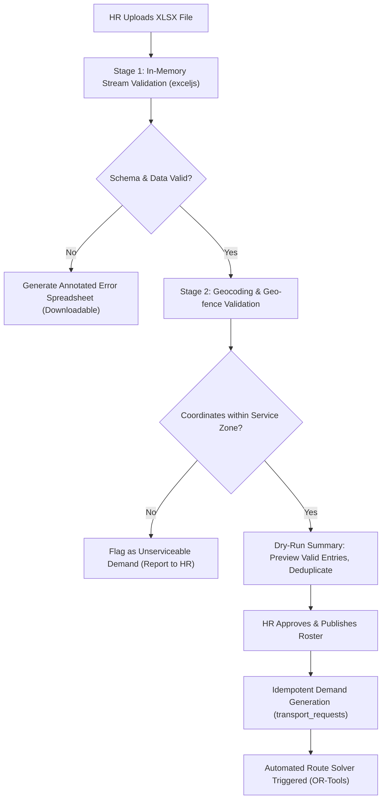

# 02 — ROSTER INGESTION & EXCEL BULK IMPORT ENGINE

**Product:** AdhocX Direct Corporate Managed Transport (ETS)  
**Document:** Roster Ingestion & Bulk Processing Specification  
**Status:** Source of Truth Baseline  
**Version:** 2.0 (Hyderabad Enterprise ETS Pilot)  
**Company:** Estemporaneo Technologies Private Limited  

---

> ### ⚠️ MANDATORY DESIGN & IMPLEMENTATION DIRECTIVE FOR ALL AI AGENTS & ENGINEERS
> Every AI agent, prompt, developer, and automated assistant modifying or contributing to this codebase **MUST STRICTLY ADHERE** to the project's foundational guidelines:
> 1. **Visual Foundation:** [`docs/04_DESIGN_SYSTEM.md and apps/marketing/DESIGN_AND_UI.md`](file:///c:/Users/saavi/Desktop/adhocx/docs/04_DESIGN_SYSTEM.md) (Colors, Typography, Spacing, Tokens, Radius, Component Styling)
> 2. **Interaction & User Journey Rules:** [`docs/05_UI_UX_GUIDELINES.md`](file:///c:/Users/saavi/Desktop/adhocx/docs/05_UI_UX_GUIDELINES.md) (Information Architecture, Screen States, Error Handling, Navigation)
> 3. **Engineering Authority & Constraints:** [`docs/20_AI_AGENT_RULES.md`](file:///c:/Users/saavi/Desktop/adhocx/docs/20_AI_AGENT_RULES.md) (Correctness > Architecture > Security > Speed. Zero hallucinated business rules. Preserved integrity).

---

# 1. Overview & Business Objectives

When Company X contracts with AdhocX, they provide a standardized roster file (e.g., transporting 500 employees daily). The Roster Ingestion Engine enables zero-touch corporate operations:
1. Corporate HR or Transport Managers upload a standardized XLSX or CSV template via the Corporate Client Portal.
2. The engine performs high-speed streaming validation, geocodes residential addresses, detects duplicate shifts, and flags unserviceable locations.
3. Upon approval, the system **autonomously converts the roster into idempotent transport requests** and triggers the route solver without requiring any manual dispatch intervention.

---

# 2. Standardized Excel/CSV Template Specification

The system distributes a locked XLSX template (`AdhocX_Corporate_Roster_Template_v2.xlsx`) with data validation drop-downs and strict headers:

| Col # | Field Name | Data Type | Required | Sample Value | Validation Rules |
| :---: | :--- | :--- | :---: | :--- | :--- |
| **A** | `employee_id` | String | **Yes** | `EMP-88410` | Unique per corporate tenant. Max 32 chars alphanumeric. |
| **B** | `full_name` | String | **Yes** | `Ananya Sharma` | 2–100 characters. Trimmed string. |
| **C** | `email` | String | **Yes** | `ananya.s@companyx.com` | Valid corporate email address format. |
| **D** | `phone_number` | String | **Yes** | `+919876543210` | E.164 format. Valid Indian 10-digit mobile number. |
| **E** | `gender` | Enum | **Yes** | `FEMALE` | `MALE`, `FEMALE`, `OTHER`. (Critical for night-shift safety rules). |
| **F** | `department` | String | No | `Engineering` | Max 64 chars. Defaults to `General`. |
| **G** | `cost_center` | String | No | `CC-ENG-402` | Used for department-level billing attribution. |
| **H** | `office_code` | String | **Yes** | `HYD-HQ-01` | Must match an active registered office under the tenant. |
| **I** | `roster_date` | Date | **Yes** | `2026-11-15` | `YYYY-MM-DD`. Must be $\ge \text{Today}$. |
| **J** | `login_time` | Time | No* | `08:00` | `HH:mm` (24-hour). Required if login pickup requested. |
| **K** | `logout_time` | Time | No* | `17:00` | `HH:mm` (24-hour). Required if logout drop requested. |
| **L** | `home_address` | String | **Yes** | `Flat 402, Lotus Apts, Madhapur, Hyderabad` | Residential pickup/drop street address. |
| **M** | `landmark` | String | No | `Near Cyber Towers Metro Station` | Aid for driver navigation. |
| **N** | `latitude` | Decimal | Optional | `17.448293` | Precision up to 6 decimal places. Auto-filled by geocoder if blank. |
| **O** | `longitude` | Decimal | Optional | `78.374128` | Precision up to 6 decimal places. Auto-filled by geocoder if blank. |
| **P** | `special_notes`| String | No | `Wheelchair ramp required` | Medical / physical accessibility flags. |

*\*Note: Each row must contain at least one of `login_time` or `logout_time`. If both are provided, the engine generates two discrete, linked transport requests.*

---

# 3. Two-Stage Processing Pipeline



### Stage 1: Fast In-Memory Stream Validation
1. **Header Integrity Check:** Checks for 100% exact match against template column definitions.
2. **Type Coercion & Schema Validation:** Validates using Zod schemas. Identifies malformed phone numbers, unparseable dates, and empty required cells.
3. **Internal Deduplication:** Detects if the same `employee_id` appears more than once for the same `roster_date` and shift direction.

### Stage 2: Geocoding & Operational Boundary Check
1. If `latitude` and `longitude` are omitted, the address is sent to the Google Maps Geocoding API with a strict bounding bias for Hyderabad (`administrative_area: Telangana`, `country: IN`).
2. PostGIS validation verifies coordinates lie within the active contract service polygon:
   ```sql
   SELECT ST_Contains(tz.service_polygon, ST_SetSRID(ST_MakePoint(lon, lat), 4326))
   FROM corporate_transport_zones tz
   WHERE tz.tenant_id = :tenant_id AND tz.office_id = :office_id;
   ```
3. If an address falls outside approved zones, it is marked `UNSERVICEABLE` and excluded from route generation with a clear reason code.

---

# 4. Idempotency & Error Handling

- **Idempotency Key:** Each imported row computes a deterministic hash:
  $$\text{hash} = \text{SHA256}(\text{tenant\_id} + \text{employee\_id} + \text{roster\_date} + \text{direction} + \text{shift\_time})$$
- If an HR user re-uploads the spreadsheet, identical rows are skipped (`ON CONFLICT DO NOTHING`), preventing duplicate transport requests.
- **Error Feedback:** If any row fails validation, the user receives:
  - An inline summary table showing row numbers, error categories, and exact failure messages.
  - A downloadable copy of their original Excel file with an added column **Validation_Errors** highlighting exact row defects in red.

---

# 5. Autonomous Demand Hand-Off to Routing Engine

Once the Corporate HR user clicks **"Approve & Publish Roster"**:
1. Roster status transitions: `DRAFT` $\to$ `VALIDATED` $\to$ `PUBLISHED`.
2. Discrete database records are inserted into `transport_requests`:
   - Direction: `PICKUP_TO_OFFICE` (Login) or `DROP_FROM_OFFICE` (Logout).
   - Target Arrival Window: $[\text{Login Time} - 15\text{ min}, \text{Login Time}]$.
   - Target Pickup Window: Computed backward from estimated travel time.
3. The engine publishes an asynchronous event:
   ```json
   {
     "event": "roster.published",
     "roster_id": "ros_998877-uuid",
     "tenant_id": "ten_corporate_client_x",
     "roster_date": "2026-11-15",
     "shift_batches": [
       { "shift_time": "08:00", "direction": "LOGIN", "passenger_count": 250 },
       { "shift_time": "09:00", "direction": "LOGIN", "passenger_count": 250 }
     ]
   }
   ```
4. BullMQ immediately queues the optimization job for the Route Optimization Solver without requiring human intervention.

---
*Refer to `03_ROUTE_OPTIMIZATION_AND_CAPACITY_SOLVER.md` for the solver specification.*

