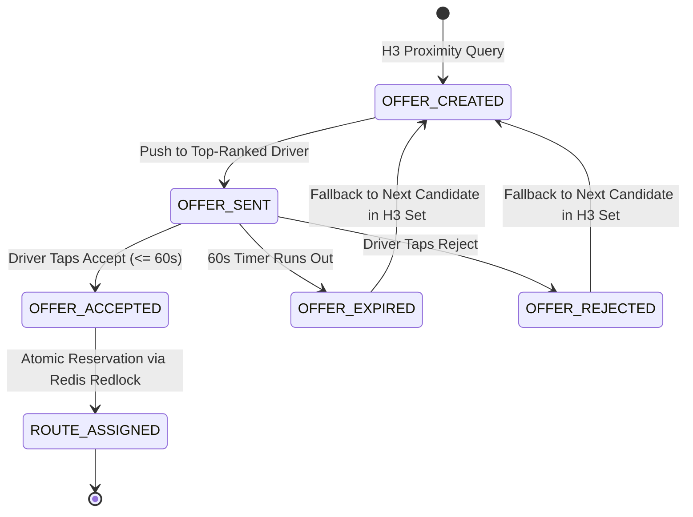

# 04 — AUTONOMOUS DISPATCH & H3 ROUTING ENGINE

**Product:** AdhocX Direct Corporate Managed Transport (ETS)  
**Document:** Autonomous Dispatch, H3 Spatial Search & Traffic Advancer Specification  
**Status:** Source of Truth Baseline  
**Version:** 2.0 (Hyderabad Enterprise ETS Pilot)  
**Company:** Estemporaneo Technologies Private Limited  

---

> ### ⚠️ MANDATORY DESIGN & IMPLEMENTATION DIRECTIVE FOR ALL AI AGENTS & ENGINEERS
> Every AI agent, prompt, developer, and automated assistant modifying or contributing to this codebase **MUST STRICTLY ADHERE** to the project's foundational guidelines:
> 1. **Visual Foundation:** [`docs/04_DESIGN_SYSTEM.md`](file:///c:/Users/saavi/Desktop/adhocx/docs/04_DESIGN_SYSTEM.md) (Colors, Typography, Spacing, Tokens, Radius, Component Styling)
> 2. **Interaction & User Journey Rules:** [`docs/05_UI_UX_GUIDELINES.md`](file:///c:/Users/saavi/Desktop/adhocx/docs/05_UI_UX_GUIDELINES.md) (Information Architecture, Screen States, Error Handling, Navigation)
> 3. **Engineering Authority & Constraints:** [`docs/20_AI_AGENT_RULES.md`](file:///c:/Users/saavi/Desktop/adhocx/docs/20_AI_AGENT_RULES.md) (Correctness > Architecture > Security > Speed. Zero hallucinated business rules. Preserved integrity).

---

# 1. The Autonomous Dispatch Mission

The AdhocX Autonomous Dispatch Engine removes human dispatchers from everyday route allocation. It operates 24x7 to match approved, optimized routes with verified independent cab-owning drivers.

### Core Guarantees:
1. **Zero-Touch Execution:** Once a roster is approved, dispatch occurs automatically without requiring admin manual clicks.
2. **Punctual Arrival Guarantee:** Drivers are dispatched with enough lead time to reach the first pickup stop on or before scheduled pickup time ($t_{\text{pickup\_1}}$).
3. **Dynamic Congestion Intelligence:** Live traffic conditions dynamically advance dispatch start times to counter severe highway jams.
4. **H3 Spatial Efficiency:** Near-instantaneous radial driver lookups using Uber H3 hexagonal spatial indexing.

---

# 2. Uber H3 Spatial Indexing Architecture

Instead of calculating computationally heavy spherical Euclidean distances across thousands of active drivers, AdhocX leverages the **Uber H3 Discrete Global Grid System**:

```text
                  ⬡ H3 Resolution 8 (Hexagon Edge ~460m)
               ⬡     ⬡
            ⬡     ⬡     ⬡  <-- Ring 1 (Immediate Vicinity: 0 to 2 km)
         ⬡     ⬡  ★  ⬡     ⬡  ★ = Stop 1 (Pickup Location)
            ⬡     ⬡     ⬡
               ⬡     ⬡     <-- Ring 2 (Primary Search: 2 to 5 km)
                  ⬡        <-- Ring 3 (Expanded Search: 5 to 10 km)
```

### Search Resolution & $k$-Ring Expansion:
- **Resolution 8:** Average hexagon area $\approx 0.737\text{ km}^2$, edge length $\approx 461\text{ meters}$.
- **Stage 1 (Primary Radius: 0 to 5 km):**  
  Compute $k$-ring around Stop 1's H3 index ($k = 6$).  
  $$\text{Target Hexagons} = 3k(k+1) + 1 = 3(6)(7) + 1 = 127\text{ hexagons}$$
  The engine filters online, eligible drivers whose latest GPS ping falls within this 127-hex set.
- **Stage 2 (Expanded Radius: 5 to 10 km):**  
  If no driver accepts within Stage 1, expand to $k = 12$ (~10 km radius):
  $$\text{Target Hexagons} = 3(12)(13) + 1 = 469\text{ hexagons}$$

---

# 3. Dynamic Dispatch Advancer (DDA) via Live Traffic Matrix

Standard static dispatch engines fail when sudden morning traffic jams occur. AdhocX incorporates an intelligent **Dynamic Dispatch Advancer (DDA)**:

### 3.1 Normal Timeline Calculation (No Congestion)
- **Office Login Time:** `08:00 AM`
- **Total Route Duration ($T_{\text{route}}$):** 1 hr 30 min (driving) + 20 min (4 stops $\times$ 5 min buffer) = **1 hr 50 min (~2 hrs)**.
- **Target Arrival at Stop 1 ($t_{\text{pickup\_1}}$):** `06:00 AM`
- **Standard Dispatch Lead Time ($\Delta t_{\text{lead}}$):** **60 minutes** before first pickup.
- **Dispatch Initiation:**
  $$t_{\text{dispatch}} = 06:00\text{ AM} - 60\text{ min} = \mathbf{05:00\text{ AM}}$$
- **Driver Match & Approach:** Driver matched by 05:30 AM; 30 minutes travel time allows reaching Stop 1 easily by 06:00 AM.

### 3.2 Dynamic Traffic Escalation (Congestion Detected)
- At **03:45 AM**, the DDA cron queries the Google Maps Distance Matrix API for the route corridor.
- If traffic latency adds 45 minutes of unexpected congestion:
  $$\Delta t_{\text{traffic\_delay}} = 45\text{ minutes}$$
- The system dynamically recalculates:
  $$t_{\text{dispatch\_advanced}} = 06:00\text{ AM} - 60\text{ min} - 45\text{ min} = \mathbf{04:15\text{ AM (or advanced to 04:00 AM)}}$$
- **Result:** Dispatch begins immediately at **04:15 AM**. The driver is secured earlier, begins driving earlier, and the cab arrives at Stop 1 on time despite severe city traffic.

---

# 4. Evening Logout (Drop-Off) Dispatch Model

For employee logout shifts (e.g., **06:00 PM Logout**):
1. **Search Center:** The corporate office transport hub.
2. **Search Radius:** Direct 10 km H3 radius around the office.
3. **Office Staging Buffer:** Driver must reach the office pickup bay **15 minutes prior to shift end**:
   $$t_{\text{office\_staging}} = 06:00\text{ PM} - 15\text{ min} = \mathbf{05:45\text{ PM}}$$
4. **Dispatch Trigger:** Initiated at **05:00 PM** (60 minutes before shift logout).
5. **Driver Reporting:** Driver arrives at office bay by 05:45 PM, scans employee boarding OTPs as employees leave the facility, and departs at 06:05 PM for residential drops.

---

# 5. Driver Ranking & Offer Lifecycle State Machine

When a route is dispatched, eligible drivers in the H3 grid are ranked using an operational score:

$$S_{\text{driver}} = w_1 \cdot \text{ETA}_{\text{pickup\_1}} + w_2 \cdot \text{AcceptanceRate} + w_3 \cdot \text{Rating} - w_4 \cdot \text{RecentOfferCount}$$



### Concurrency & Double-Booking Protection:
- **Redis Redlock:** When a driver taps "Accept", the backend acquires a distributed mutex on `lock:route:{route_id}`.
- If two drivers attempt acceptance simultaneously, exactly one succeeds; the second receives an explicit `"Offer Already Committed"` response.
- **Escalation Alarm:** If a route remains unassigned at $t_{\text{pickup\_1}} - 30\text{ min}$, an audible high-severity alert triggers on the **AdhocX Super Admin Trips & Ride Management Panel**, enabling manual operator dispatch override.

---
*Refer to `05_TRIP_EXECUTION_OTP_AND_5MIN_NO_SHOW_LIFECYCLE.md` for live ride execution.*

