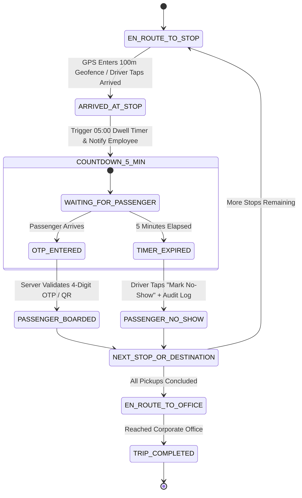

# 05 — TRIP EXECUTION, OTP & 5-MINUTE NO-SHOW LIFECYCLE

**Product:** AdhocX Direct Corporate Managed Transport (ETS)  
**Document:** Live Trip Execution, Verification & No-Show Protocol  
**Status:** Source of Truth Baseline  
**Version:** 2.0 (Hyderabad Enterprise ETS Pilot)  
**Company:** Estemporaneo Technologies Private Limited  

---

> ### ⚠️ MANDATORY DESIGN & IMPLEMENTATION DIRECTIVE FOR ALL AI AGENTS & ENGINEERS
> Every AI agent, prompt, developer, and automated assistant modifying or contributing to this codebase **MUST STRICTLY ADHERE** to the project's foundational guidelines:
> 1. **Visual Foundation:** [`docs/04_DESIGN_SYSTEM.md`](file:///c:/Users/saavi/Desktop/adhocx/docs/04_DESIGN_SYSTEM.md) (Colors, Typography, Spacing, Tokens, Radius, Component Styling)
> 2. **Interaction & User Journey Rules:** [`docs/05_UI_UX_GUIDELINES.md`](file:///c:/Users/saavi/Desktop/adhocx/docs/05_UI_UX_GUIDELINES.md) (Information Architecture, Screen States, Error Handling, Navigation)
> 3. **Engineering Authority & Constraints:** [`docs/20_AI_AGENT_RULES.md`](file:///c:/Users/saavi/Desktop/adhocx/docs/20_AI_AGENT_RULES.md) (Correctness > Architecture > Security > Speed. Zero hallucinated business rules. Preserved integrity).

---

# 1. End-to-End Stop Execution Lifecycle

A corporate pooled route consists of ordered sequential stops (e.g. 4 employee residential pickups $\to$ 1 corporate office destination). Every pickup stop follows a rigorous state machine to protect punctuality and generate auditable operational logs.

---

# 2. Arrival Detection & Passenger Alerting

1. **Geofenced Arrival:** When the driver's device GPS comes within **100 meters** of the registered pickup coordinates, the backend emits `cab.arrived`.
2. **Driver Arrival Confirmation:** The Driver Mobile App prompts: `"You have arrived at Stop 1 ([Passenger Name])"`.
3. **Employee Push Notification:** The Employee Mobile App immediately sounds a priority alert:
   - *Headline:* `"Your AdhocX Cab Has Arrived!"`
   - *Body:* `"Vehicle [Plate] is waiting outside. Please board within 5 minutes with your OTP: [4291]."`

---

# 3. The 5-Minute Waiting Buffer Protocol

To prevent one tardy passenger from causing downstream employees to miss their shift login, AdhocX enforces a strict **5-minute dwell timer rule**:

### Driver Mobile Interface During Wait:
- A prominent circular countdown timer displays **05:00 $\to$ 00:00** in high-contrast amber.
- The screen displays:
  - Passenger Name & masked phone call button (virtual proxy call).
  - Numeric keypad to input passenger OTP.
  - QR Code Scanner button.
  - Disabled `"Mark No-Show"` button (disabled until timer reaches `00:00` or driver completes 5 minutes at geofence).

---

# 4. Boarding Verification (OTP / QR Challenge)

### Happy Path: Employee Boards Within 5 Minutes
1. Employee walks to the vehicle and shows their dynamic **4-digit numeric OTP** or QR code displayed on the Employee Mobile App.
2. Driver enters the 4-digit code on the Driver Mobile App.
3. API verifies OTP against `trip_passengers`:
   - Verification Success: App displays green confirmation haptic.
   - Status updates to `BOARDED`. Boarding timestamp recorded with GPS lat/lon.
   - Driver navigates to Stop 2.

### Exception Path: Employee Exceeds 5-Minute Buffer (No-Show)
1. The 5:00 minute countdown reaches `00:00`.
2. The Driver Mobile App sounds an alert and unlocks the red **`"Mark No-Show (Employee Absent)"`** button.
3. Driver taps `"Mark No-Show"`. A mandatory confirmation dialog appears:
   - `"Confirm that employee [Name] did not arrive at pickup point after 5 minutes?"`
4. Driver confirms. The system performs atomic updates:
   - Passenger status: `NO_SHOW`.
   - Reason: `PASSENGER_UNAVAILABLE_AFTER_5_MIN_BUFFER`.
   - Geo-coordinates, device battery, and timestamps are sealed in `boarding_events`.
5. **Immediate Notification:**
   - Employee App: `"You were marked as a No-Show. The cab had to proceed to avoid delay for other passengers."`
   - Corporate Client Portal: The real-time attendance monitor immediately logs the employee as **Absent / No-Show (Missed Cab)**.
6. Driver app immediately transitions to navigation for Stop 2.

---

# 5. Office Drop & Trip Completion

1. Once the final residential pickup is completed (either `BOARDED` or `NO_SHOW`), the Driver App sets navigation directly to the **Corporate Office Transport Bay**.
2. **Geofenced Destination Arrival:** Driver enters the office geofence.
3. Driver taps **`"Complete Trip"`**.
4. The system validates:
   - At least one passenger boarded OR all passengers marked no-show.
   - Status transitions to `COMPLETED`.
   - Generates dual financial ledger lines (see Doc 13).
   - Employee apps receive a `"Trip Completed — Thank you for traveling with AdhocX"` card with optional driver rating (1–5 stars).

---
*Refer to `06_RESCHEDULE_AND_CANCELLATION_ENGINE.md` for ride changes prior to dispatch.*

