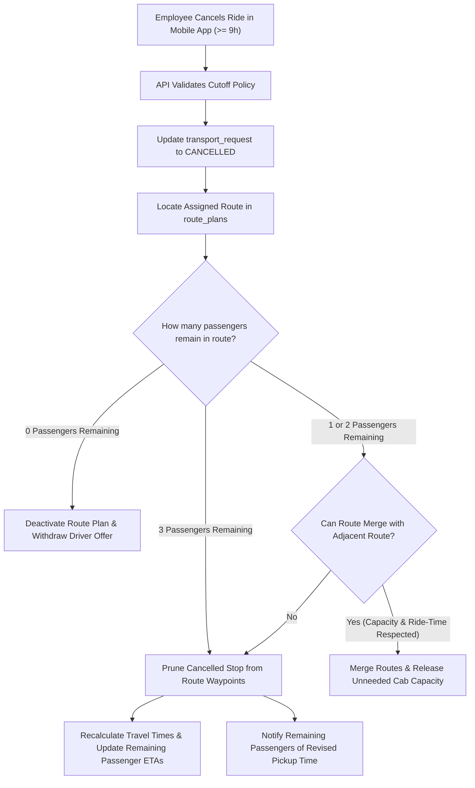

# 06 — RESCHEDULE & CANCELLATION ENGINE

**Product:** AdhocX Direct Corporate Managed Transport (ETS)  
**Document:** Ride Rescheduling, Cancellation Rules & Route Re-Optimization Specification  
**Status:** Source of Truth Baseline  
**Version:** 2.0 (Hyderabad Enterprise ETS Pilot)  
**Company:** Estemporaneo Technologies Private Limited  

---

> ### ⚠️ MANDATORY DESIGN & IMPLEMENTATION DIRECTIVE FOR ALL AI AGENTS & ENGINEERS
> Every AI agent, prompt, developer, and automated assistant modifying or contributing to this codebase **MUST STRICTLY ADHERE** to the project's foundational guidelines:
> 1. **Visual Foundation:** [`docs/04_DESIGN_SYSTEM.md and apps/marketing/DESIGN_AND_UI.md`](file:///c:/Users/saavi/Desktop/adhocx/docs/04_DESIGN_SYSTEM.md) (Colors, Typography, Spacing, Tokens, Radius, Component Styling)
> 2. **Interaction & User Journey Rules:** [`docs/05_UI_UX_GUIDELINES.md`](file:///c:/Users/saavi/Desktop/adhocx/docs/05_UI_UX_GUIDELINES.md) (Information Architecture, Screen States, Error Handling, Navigation)
> 3. **Engineering Authority & Constraints:** [`docs/20_AI_AGENT_RULES.md`](file:///c:/Users/saavi/Desktop/adhocx/docs/20_AI_AGENT_RULES.md) (Correctness > Architecture > Security > Speed. Zero hallucinated business rules. Preserved integrity).

---

# 1. Business Context & Objective

In enterprise employee transport, shifts fluctuate dynamically. Employees take leave, work from home, or get reassigned to different shifts by their managers (e.g., shifted from 07:00 AM to 09:00 AM). 

The **Reschedule & Cancellation Engine** enables employees to cancel or modify rides directly from their Employee Mobile App under strict corporate cutoff rules, while automatically triggering intelligent route re-balancing without human dispatcher involvement.

---

# 2. The 9-Hour Cutoff Policy Window

To ensure predictable vehicle commitments and prevent driver dry runs, corporate clients configure cutoff windows. The system default is **9 hours prior to scheduled pickup time**:

$$\text{Cutoff Threshold} = t_{\text{scheduled\_pickup}} - 9\text{ hours}$$

### Concrete Example (User Scenario):
- **Employee Assignment:** Route 12, Stop 2.
- **Scheduled Pickup Time:** `07:00 AM` (Tomorrow morning).
- **Cutoff Deadline:**
  $$\text{Deadline} = 07:00\text{ AM} - 9\text{ hours} = \mathbf{10:00\text{ PM (Previous Night)}}$$
- **Window Evaluation:**
  - **Self-Service Cancellation (Prior to 10:00 PM):** Approved instantly and automatically processed by the route rebalancer.
  - **Late Cancellation Request (After 10:00 PM):** Flagged as `LATE_CANCELLATION`. Requires Corporate HR/Transport Manager approval or incurs a corporate policy flag.

```mermaid
timeline
    title Timeline for 07:00 AM Morning Pickup
    10:00 AM (Previous Day) : Roster Published & Routes Optimized
    06:00 PM - 10:00 PM : Permitted Self-Service Cancellation Window (>= 9h)
    10:00 PM : Cutoff Passes (Late Cancellation Rules Apply)
    06:00 AM : Autonomous Dispatch Initiated (1h before pickup)
    07:00 AM : Cab Arrives at Stop 2
```

---

# 3. Dynamic Route Re-Balancing Subsystem

When an employee cancels their ride before the cutoff, the system executes an automated re-optimization workflow:



### 3.1 Stop Pruning & Sequence Recalculation
- The removed employee's residential waypoint is deleted from the route stop graph.
- The Google Maps Directions engine recalculates the driving trajectory between Stop 1, Stop 3, and Stop 4.
- If the trip duration decreases, the system recalculates pickup times for subsequent stops and broadcasts updated ETAs via push notifications:
  - *Example Notification:* `"Your pickup time for Route 12 has been adjusted by 6 minutes. New pickup: 07:14 AM."`

### 3.2 Vehicle Capacity Optimization (Route Merging)
- If two adjacent routes in the same geographic cluster drop to 2 passengers each, the solver checks if merging them into a single 4-passenger sedan violates the 120-minute Maximum Employee Ride Time (MERT).
- If compliant, the routes merge into one, instantly saving the corporate client the cost of an extra cab.

---

# 4. Shift Rescheduling Workflow (e.g. 07:00 AM $\to$ 09:00 AM)

If an employee is instructed to attend a later shift:
1. **Request Submission:** In the Employee Mobile App, the employee selects `"Reschedule Ride"`, chooses the new shift (`09:00 AM Login`), and submits.
2. **Atomic Swap:**
   - Existing 07:00 AM request is marked `RESCHEDULED`.
   - A new transport request is generated for the 09:00 AM batch.
3. **Solver Ingestion:**
   - The 07:00 AM route prunes the stop.
   - The 09:00 AM solver batch ingests the employee request into an existing 09:00 AM route with available seating ($< 4$ passengers) or creates an overflow route.
4. **Instant Confirmation:** The employee receives immediate feedback showing their new tentative pickup time (e.g., 07:35 AM for 09:00 AM login).

---
*Refer to `07_CORPORATE_CLIENT_PORTAL_SPECIFICATION.md` for corporate oversight screens.*

