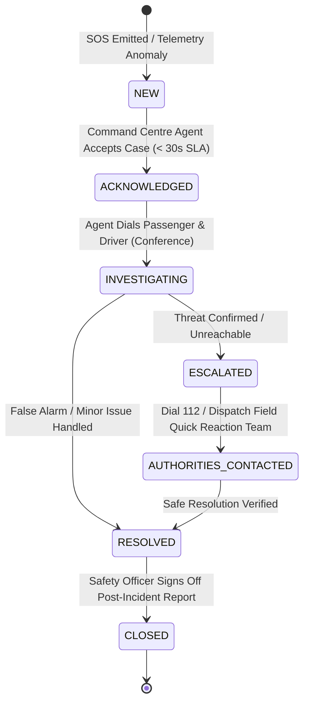

# 11 — SAFETY, SOS & COMMAND CENTRE OPERATIONS

**Product:** AdhocX Direct Corporate Managed Transport (ETS)  
**Document:** 24x7 Command Centre, SOS Protocols & Incident Escalation Specification  
**Status:** Source of Truth Baseline  
**Version:** 2.0 (Hyderabad Enterprise ETS Pilot)  
**Company:** Estemporaneo Technologies Private Limited  

---

> ### ⚠️ MANDATORY DESIGN & IMPLEMENTATION DIRECTIVE FOR ALL AI AGENTS & ENGINEERS
> Every AI agent, prompt, developer, and automated assistant modifying or contributing to this codebase **MUST STRICTLY ADHERE** to the project's foundational guidelines:
> 1. **Visual Foundation:** [`docs/04_DESIGN_SYSTEM.md`](file:///c:/Users/saavi/Desktop/adhocx/docs/04_DESIGN_SYSTEM.md) (Colors, Typography, Spacing, Tokens, Radius, Component Styling)
> 2. **Interaction & User Journey Rules:** [`docs/05_UI_UX_GUIDELINES.md`](file:///c:/Users/saavi/Desktop/adhocx/docs/05_UI_UX_GUIDELINES.md) (Information Architecture, Screen States, Error Handling, Navigation)
> 3. **Engineering Authority & Constraints:** [`docs/20_AI_AGENT_RULES.md`](file:///c:/Users/saavi/Desktop/adhocx/docs/20_AI_AGENT_RULES.md) (Correctness > Architecture > Security > Speed. Zero hallucinated business rules. Preserved integrity).

---

# 1. Mission & Operational Boundary

Corporate employee safety is a zero-tolerance priority. AdhocX operates a **24x7 Command Centre** tasked with real-time route monitoring, proactive telemetry anomaly detection, emergency SOS response, and incident escalation for all corporate client tenants.

*Boundary Disclaimer: The in-app SOS feature is an operational distress channel connecting directly to the AdhocX Command Centre and corporate safety officers. It provides clear in-app instructions to contact public emergency services (Dial 112) and is not a legal substitute for public police or ambulance dispatch.*

---

# 2. Automated Telemetry Alert Triggers

The telemetry engine evaluates continuous GPS streams from active vehicles against configured threshold rules:

| Trigger Code | Anomaly Condition | Evaluation Window | Command Centre Severity | Automated Action |
| :---: | :--- | :---: | :---: | :--- |
| **SOS-EMERGENCY** | Employee or Driver taps SOS button in app. | Instantaneous ($< 1\text{s}$) | **P0 (CRITICAL)** | Audio siren in console, auto-call trigger, SMS to emergency contacts. |
| **ROUTE-DEVIATE** | Vehicle diverges $> 500\text{ meters}$ from planned route polyline. | Sustained $\ge 3\text{ minutes}$ | **P1 (HIGH)** | Visual alert banner, automatic outbound call to driver. |
| **PROLONGED-STOP**| Vehicle stationary ($< 3\text{ km/h}$) at an unapproved stop. | Sustained $\ge 10\text{ minutes}$ | **P1 (HIGH)** | Telemetry ping to driver app, dispatcher check-in prompt. |
| **OVERSPEED** | Vehicle speed exceeds $80\text{ km/h}$ on city corridors. | Sustained $\ge 30\text{ seconds}$ | **P2 (MEDIUM)** | In-app audio warning to driver: *"Please adhere to safe speed limits"*. |
| **GPS-STALE** | Zero GPS coordinates received while trip is `IN_PROGRESS`. | Sustained $\ge 60\text{ seconds}$ | **P2 (MEDIUM)** | Mark vehicle as `GPS_STALE` on live maps, initiate network check. |

---

# 3. In-App SOS Interaction & Data Payload

### 3.1 Trigger Flow (Employee or Driver App)
1. User taps the red **`[ SOS ]`** button available on all active ride screens.
2. An overlay appears with a **3-second abort countdown** (to prevent accidental triggers).
3. If not cancelled, the app emits a high-priority WebSocket frame and parallel HTTPS fallback to `/v1/trips/{id}/sos`.
4. The client transmits the rich emergency context:
   ```json
   {
     "trip_id": "trp_98234-uuid",
     "actor_role": "EMPLOYEE",
     "employee_id": "EMP-88410",
     "driver_id": "drv_5512-uuid",
     "vehicle_plate": "TS09UB4410",
     "latitude": 17.448293,
     "longitude": 78.374128,
     "altitude": 542.1,
     "speed_kmh": 42.5,
     "bearing": 184.2,
     "device_battery_level": 74,
     "device_timestamp": "2026-11-15T06:22:14.120Z",
     "tenant_id": "ten_corporate_client_x"
   }
   ```

---

# 4. Incident Lifecycle & SLA Escalation Matrix

Every safety incident transitions through a rigorous state machine:



### SLA Targets:
- **P0 SOS Acknowledgment:** $\le 30\text{ seconds}$ from trigger to human agent pickup.
- **P0 Passenger Contact:** $\le 60\text{ seconds}$ via automated voice bridge.
- **Corporate Safety Officer Alert:** $\le 2\text{ minutes}$ via automated SMS/Email webhook.
- **Police Escalation (Dial 112):** Executed immediately if passenger reports physical distress or cab remains unreachable for $> 3\text{ minutes}$ during confirmed deviation.

---

# 5. Night-Shift Female Commute Safeguards

In compliance with corporate governance standards and Telangana state transport regulations:
1. **Escort Assignment:** Any female employee picked up between **20:00 (8:00 PM)** and **06:00 (6:00 AM)** who is either the first pickup or last drop-off MUST have a verified security escort seated in the cab, OR the route algorithm must re-sequence pickups such that a male employee or co-passenger is onboard.
2. **Safe-Reach Confirmation:** Upon drop-off at home, the Employee Mobile App prompts:
   `"Have you reached safely inside your residence?"`
   - Employee taps **`"Yes, Safe"`** within 10 minutes.
   - If unconfirmed, the Command Centre receives a safe-reach check alert to verify via phone.

---
*Refer to `12_REALTIME_GPS_TRACKING_AND_NOTIFICATIONS.md` for live streaming infrastructure.*

