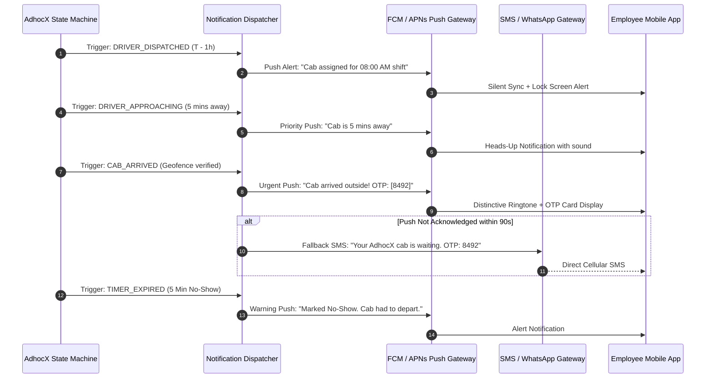

# 12 — REALTIME GPS TRACKING & NOTIFICATIONS

**Product:** AdhocX Direct Corporate Managed Transport (ETS)  
**Document:** Telemetry Ingestion, GPS Freshness & Multi-Channel Notification Engine  
**Status:** Source of Truth Baseline  
**Version:** 2.0 (Hyderabad Enterprise ETS Pilot)  
**Company:** Estemporaneo Technologies Private Limited  

---

> ### ⚠️ MANDATORY DESIGN & IMPLEMENTATION DIRECTIVE FOR ALL AI AGENTS & ENGINEERS
> Every AI agent, prompt, developer, and automated assistant modifying or contributing to this codebase **MUST STRICTLY ADHERE** to the project's foundational guidelines:
> 1. **Visual Foundation:** [`docs/04_DESIGN_SYSTEM.md and apps/marketing/DESIGN_AND_UI.md`](file:///c:/Users/saavi/Desktop/adhocx/docs/04_DESIGN_SYSTEM.md) (Colors, Typography, Spacing, Tokens, Radius, Component Styling)
> 2. **Interaction & User Journey Rules:** [`docs/05_UI_UX_GUIDELINES.md`](file:///c:/Users/saavi/Desktop/adhocx/docs/05_UI_UX_GUIDELINES.md) (Information Architecture, Screen States, Error Handling, Navigation)
> 3. **Engineering Authority & Constraints:** [`docs/20_AI_AGENT_RULES.md`](file:///c:/Users/saavi/Desktop/adhocx/docs/20_AI_AGENT_RULES.md) (Correctness > Architecture > Security > Speed. Zero hallucinated business rules. Preserved integrity).

---

# 1. Telemetry Ingestion Architecture

Live vehicle tracking operates under strict battery, network bandwidth, and accuracy constraints. The Driver Mobile App runs a native background location service transmitting geo-telemetry to the AdhocX Realtime Gateway:

```mermaid
flowchart LR
    DriverDevice["Driver Mobile App<br/>(Background Geolocation)"] -->|WSS / Socket.IO (15-30s pings)| WSServer["AdhocX Realtime Gateway<br/>(NestJS WebSockets)"]
    WSServer -->|Update Ephemeral Location| RedisStore[("Redis Cluster<br/>GEOADD driver_positions")]
    WSServer -->|Publish Location Event| RedisPubSub["Redis Pub/Sub Channel<br/>trip:updates:{trip_id}"]
    RedisPubSub --> ClientFanout["Socket Fanout & Room Broadcast"]
    ClientFanout --> EmpApp["Employee Mobile App<br/>(Subscribed Room)"]
    ClientFanout --> CorpDashboard["Corporate Client Portal<br/>(Tenant Live Map)"]
    ClientFanout --> OpsConsole["Super Admin Command Centre<br/>(Global Operations Map)"]
    WSServer -->|Batched Archive (60s)| TimescalePostgres[("PostgreSQL Partitioned<br/>vehicle_positions")]
```

---

# 2. GPS Freshness Protocol: Stale vs. Live

A fundamental tenet of AdhocX engineering (mandated by PRD Section 6) is:
> **"Location data access is purpose-limited and last-seen age must be visible; GPS stale is not live."**

The platform prohibits dead reckoning extrapolations or presenting outdated coordinates as active movement. Every UI client renders the explicit telemetry state:

| Telemetry State | Condition Elapsed Since Last Ping | Map Display Treatment | UI Banner / Badge |
| :---: | :---: | :--- | :--- |
| **LIVE** | $0 \le \Delta t \le 30\text{ seconds}$ | Smooth vehicle marker, animated pulse. | 🟢 `Live Tracking` |
| **LAGGING** | $31 \le \Delta t \le 60\text{ seconds}$ | Marker static; pulse stops. | 🟡 `Updating (35s ago)` |
| **STALE** | $61 \le \Delta t \le 180\text{ seconds}$ | Vehicle icon turns amber; path greys out. | 🟠 `GPS Stale (2m ago) — Weak Network` |
| **OFFLINE** | $\Delta t > 180\text{ seconds}$ | Vehicle icon turns grey with exclamation badge. | 🔴 `Cab Offline (Last seen 5m ago)` |

---

# 3. Mobile Power & Data Conservation Rules

To prevent draining driver smartphone batteries during 8–10 hour shifts:
1. **Dynamic Frequency Throttle:**
   - Vehicle Moving ($> 5\text{ km/h}$): Pings sent every **15 to 30 seconds**.
   - Vehicle Stationary / Waiting at Stop: Throttle backs off to **60 seconds**.
   - Offline / Off-Duty: GPS background service terminated immediately.
2. **Exponential Backoff on Reconnect:**
   - If cellular connection drops, the mobile client buffers up to 200 location points locally in SQLite.
   - Upon reconnection, points are uploaded in a single compressed batch, preventing network buffer bloat.

---

# 4. Multi-Channel Notification Lifecycle

The notification engine delivers deterministic alerts across Mobile Push (FCM / APNs), SMS (Twilio / Gupshup), and WhatsApp:



---
*Refer to `13_DUAL_FINANCIAL_LEDGERS_BILLING_AND_PAYOUTS.md` for billing and payout mechanics.*

