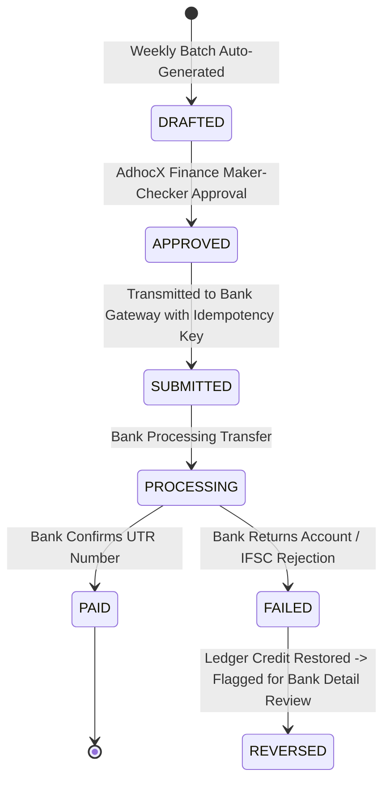

# 13 — DUAL FINANCIAL LEDGERS, BILLING & PAYOUTS

**Product:** AdhocX Direct Corporate Managed Transport (ETS)  
**Document:** Corporate Invoicing, Driver Compensation & Dual-Ledger Accounting Specification  
**Status:** Source of Truth Baseline  
**Version:** 2.0 (Hyderabad Enterprise ETS Pilot)  
**Company:** Estemporaneo Technologies Private Limited  

---

> ### ⚠️ MANDATORY DESIGN & IMPLEMENTATION DIRECTIVE FOR ALL AI AGENTS & ENGINEERS
> Every AI agent, prompt, developer, and automated assistant modifying or contributing to this codebase **MUST STRICTLY ADHERE** to the project's foundational guidelines:
> 1. **Visual Foundation:** [`docs/04_DESIGN_SYSTEM.md`](file:///c:/Users/saavi/Desktop/adhocx/docs/04_DESIGN_SYSTEM.md) (Colors, Typography, Spacing, Tokens, Radius, Component Styling)
> 2. **Interaction & User Journey Rules:** [`docs/05_UI_UX_GUIDELINES.md`](file:///c:/Users/saavi/Desktop/adhocx/docs/05_UI_UX_GUIDELINES.md) (Information Architecture, Screen States, Error Handling, Navigation)
> 3. **Engineering Authority & Constraints:** [`docs/20_AI_AGENT_RULES.md`](file:///c:/Users/saavi/Desktop/adhocx/docs/20_AI_AGENT_RULES.md) (Correctness > Architecture > Security > Speed. Zero hallucinated business rules. Preserved integrity).

---

# 1. Dual-Ledger Financial Isolation Architecture

AdhocX operates an enterprise managed transport business model with two completely independent, decoupled financial ledgers:

```text
                  ┌──────────────────────────────────────────────┐
                  │          TRIP COMPLETION EVENT               │
                  │   (trip_id: trp_8899, distance: 28.5 km)     │
                  └──────────────────────┬───────────────────────┘
                                         │
             ┌───────────────────────────┴───────────────────────────┐
             ▼                                                       ▼
┌────────────────────────────────────────┐       ┌────────────────────────────────────────┐
│      LEDGER A: CORPORATE RECEIVABLES   │       │       LEDGER B: DRIVER PAYABLES        │
├────────────────────────────────────────┤       ├────────────────────────────────────────┤
│ Entity: Corporate Client (Company X)   │       │ Entity: Independent Cab Owner (Driver) │
│ Rate Card: Contracted Corporate Tariff │       │ Rate Card: AdhocX Driver Supply Tariff │
│ Example Line Items:                    │       │ Example Line Items:                    │
│ • Base Route Rate (Sedan): ₹ 1,200.00  │       │ • Contracted Route Payout:  ₹ 850.00   │
│ • Excess Distance (3.5 km): ₹   52.50  │       │ • Morning Shift Bonus:     ₹  50.00   │
│ • Dwell Time / Wait:        ₹    0.00  │       │ • Toll Reimbursement:      ₹  75.00   │
│ • Subtotal:                ₹ 1,252.50  │       │ • Total Driver Credit:     ₹ 975.00   │
│ • GST (5% / 18%):          ₹   62.63   │       │                                        │
│ • Total Corporate Bill:    ₹ 1,315.13  │       │ (AdhocX Platform Gross Margin =        │
├────────────────────────────────────────┤       │  ₹ 1,252.50 - ₹ 900.00 = ₹ 352.50)     │
│ 👁️ VISIBLE TO:                         │       ├────────────────────────────────────────┤
│ • Corporate Portal Finance Managers    │       │ 👁️ VISIBLE TO:                         │
│ • AdhocX Finance Approvers             │       │ • Driver Mobile App (Earnings)         │
│ 🚫 FORBIDDEN TO: Independent Drivers   │       │ • AdhocX Finance Approvers             │
└────────────────────────────────────────┘       │ 🚫 STRICTLY CONFIDENTIAL FROM CLIENT   │
                                                 └────────────────────────────────────────┘
```

*Absolute Isolation Directive: No corporate client, HR, or finance user can ever query or view internal driver compensation rates or platform gross margins. Similarly, drivers have zero visibility into corporate contract billables.*

---

# 2. Strict Integer Arithmetic (Zero Floating Point)

To prevent rounding errors and financial reconciliation drift:
1. **Integer Minor Units:** All monetary values in database columns, API payloads, and state machines are stored in **INR Paise** (1 Rupee = 100 Paise).
   - ₹ 1,250.00 $\implies$ `125000`
   - ₹ 850.50 $\implies$ `85050`
2. **Immutable Adjustments:** Financial rows are append-only. Settled invoices or payouts are never overwritten; adjustments require distinct `credit_note` or `debit_adjustment` entries.

---

# 3. Corporate Rate Card Modeling

Corporate contracts define versioned rate rules applied to each completed route:

```json
{
  "rate_card_id": "rc_corp_companyx_v2",
  "tenant_id": "ten_corporate_client_x",
  "vehicle_category": "SEDAN",
  "base_fare_paise": 120000,
  "base_distance_meters": 25000,
  "extra_distance_rate_per_km_paise": 1500,
  "free_wait_minutes_per_stop": 5,
  "extra_wait_charge_per_minute_paise": 400,
  "late_cancellation_fee_paise": 60000,
  "no_show_passenger_fee_paise": 60000,
  "toll_reimbursement": "AT_ACTUALS",
  "effective_from": "2026-11-01T00:00:00Z"
}
```

---

# 4. Driver Payout Rate Cards & Automated Batches

### 4.1 Independent Driver Rate Structure
- **Guaranteed Route Base:** Fixed payout for completing the 4-stop sedan route within planned distance (e.g. ₹ 850.00).
- **Approach / Deadhead Incentive:** Calculated if the driver traveled $> 7\text{ km}$ during approach.
- **Toll & Fastag Reimbursement:** Direct 1-to-1 credit based on validated electronic toll logs.

### 4.2 Payout Batch State Machine
Driver earnings accumulate in an immutable digital ledger. Payout batches execute via automated banking rails (e.g., RazorpayX / IMPS / NEFT):



### Idempotency Key Formula:
$$\text{IdempotencyKey} = \text{SHA256}(\text{payout\_batch\_id} + \text{driver\_id} + \text{amount\_paise} + \text{bank\_account\_number})$$
Guarantees that network retries or gateway timeouts can NEVER execute duplicate bank wire transfers.

---
*Refer to `14_DATABASE_SCHEMA_POSTGIS_AND_DATA_CONTRACTS.md` for database table definitions.*

