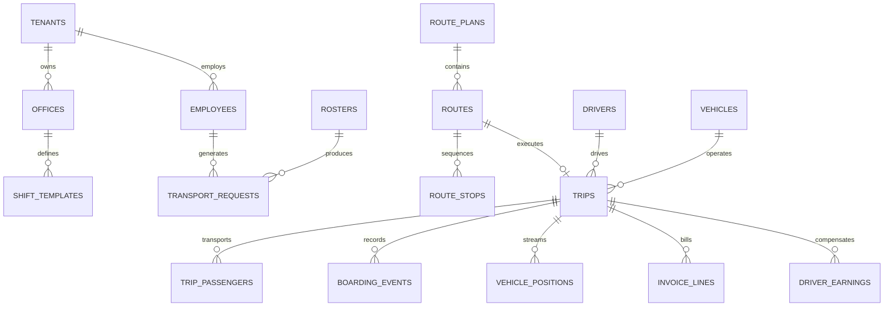

# 14 — DATABASE SCHEMA, POSTGIS & DATA CONTRACTS

**Product:** AdhocX Direct Corporate Managed Transport (ETS)  
**Document:** Database Schema DDL, PostGIS Architecture & Multi-Tenant Data Contracts  
**Status:** Source of Truth Baseline  
**Version:** 2.0 (Hyderabad Enterprise ETS Pilot)  
**Company:** Estemporaneo Technologies Private Limited  

---

> ### ⚠️ MANDATORY DESIGN & IMPLEMENTATION DIRECTIVE FOR ALL AI AGENTS & ENGINEERS
> Every AI agent, prompt, developer, and automated assistant modifying or contributing to this codebase **MUST STRICTLY ADHERE** to the project's foundational guidelines:
> 1. **Visual Foundation:** [`docs/04_DESIGN_SYSTEM.md`](file:///c:/Users/saavi/Desktop/adhocx/docs/04_DESIGN_SYSTEM.md) (Colors, Typography, Spacing, Tokens, Radius, Component Styling)
> 2. **Interaction & User Journey Rules:** [`docs/05_UI_UX_GUIDELINES.md`](file:///c:/Users/saavi/Desktop/adhocx/docs/05_UI_UX_GUIDELINES.md) (Information Architecture, Screen States, Error Handling, Navigation)
> 3. **Engineering Authority & Constraints:** [`docs/20_AI_AGENT_RULES.md`](file:///c:/Users/saavi/Desktop/adhocx/docs/20_AI_AGENT_RULES.md) (Correctness > Architecture > Security > Speed. Zero hallucinated business rules. Preserved integrity).

---

# 1. Database Architecture & PostGIS Standards

AdhocX ETS uses **PostgreSQL 16** with the **PostGIS 3.4** extension enabled.
- **Identifiers:** Primary keys are UUIDv4 strings.
- **Timestamps:** All time fields use `TIMESTAMPTZ` stored in UTC.
- **Geospatial Types:** Stored as `GEOMETRY(Point, 4326)` using WGS 84 latitude/longitude coordinates.
- **Spatial Indexes:** Indexed with `CREATE INDEX ... USING GIST (geom)`.
- **H3 Indices:** Stored as `BIGINT` or `VARCHAR(15)` for rapid integer-based k-ring spatial joins.
- **Money Values:** Stored as `BIGINT` minor units (INR Paise).

---

# 2. Entity-Relationship Overview



---

# 3. Core PostgreSQL DDL Specifications

```sql
-- Enable PostGIS extension
CREATE EXTENSION IF NOT EXISTS postgis;
CREATE EXTENSION IF NOT EXISTS "uuid-ossp";

-- 1. TENANTS & CORPORATE OFFICES
CREATE TABLE tenants (
    id UUID PRIMARY KEY DEFAULT uuid_generate_v4(),
    code VARCHAR(32) UNIQUE NOT NULL,
    name VARCHAR(255) NOT NULL,
    legal_entity_name VARCHAR(255) NOT NULL,
    gstin VARCHAR(15),
    status VARCHAR(32) NOT NULL DEFAULT 'ACTIVE', -- ACTIVE, SUSPENDED
    created_at TIMESTAMPTZ NOT NULL DEFAULT NOW(),
    updated_at TIMESTAMPTZ NOT NULL DEFAULT NOW()
);

CREATE TABLE offices (
    id UUID PRIMARY KEY DEFAULT uuid_generate_v4(),
    tenant_id UUID NOT NULL REFERENCES tenants(id) ON DELETE CASCADE,
    code VARCHAR(32) NOT NULL,
    name VARCHAR(255) NOT NULL,
    address_text TEXT NOT NULL,
    location_geom GEOMETRY(Point, 4326) NOT NULL,
    h3_res8_index VARCHAR(15) NOT NULL,
    created_at TIMESTAMPTZ NOT NULL DEFAULT NOW(),
    CONSTRAINT uq_tenant_office UNIQUE (tenant_id, code)
);
CREATE INDEX idx_offices_geom ON offices USING GIST(location_geom);

-- 2. EMPLOYEES & HOME GEOLOCATIONS
CREATE TABLE employees (
    id UUID PRIMARY KEY DEFAULT uuid_generate_v4(),
    tenant_id UUID NOT NULL REFERENCES tenants(id) ON DELETE CASCADE,
    office_id UUID NOT NULL REFERENCES offices(id),
    employee_code VARCHAR(64) NOT NULL,
    full_name VARCHAR(255) NOT NULL,
    email VARCHAR(255) NOT NULL,
    phone_number VARCHAR(20) NOT NULL,
    gender VARCHAR(16) NOT NULL, -- MALE, FEMALE, OTHER
    department VARCHAR(64),
    cost_center VARCHAR(64),
    is_active BOOLEAN NOT NULL DEFAULT TRUE,
    created_at TIMESTAMPTZ NOT NULL DEFAULT NOW(),
    CONSTRAINT uq_tenant_emp_code UNIQUE (tenant_id, employee_code)
);

CREATE TABLE employee_locations (
    id UUID PRIMARY KEY DEFAULT uuid_generate_v4(),
    employee_id UUID NOT NULL REFERENCES employees(id) ON DELETE CASCADE,
    address_text TEXT NOT NULL,
    landmark TEXT,
    location_geom GEOMETRY(Point, 4326) NOT NULL,
    h3_res8_index VARCHAR(15) NOT NULL,
    is_default BOOLEAN NOT NULL DEFAULT TRUE,
    created_at TIMESTAMPTZ NOT NULL DEFAULT NOW()
);
CREATE INDEX idx_emp_locations_geom ON employee_locations USING GIST(location_geom);

-- 3. DRIVERS & DIRECT VEHICLE COMPLIANCE (NO VENDOR BROKERAGE)
CREATE TABLE drivers (
    id UUID PRIMARY KEY DEFAULT uuid_generate_v4(),
    phone_number VARCHAR(20) UNIQUE NOT NULL,
    full_name VARCHAR(255) NOT NULL,
    dl_number VARCHAR(64) UNIQUE NOT NULL,
    pan_number VARCHAR(10) NOT NULL,
    aadhaar_masked VARCHAR(12) NOT NULL,
    verification_status VARCHAR(32) NOT NULL DEFAULT 'PENDING', -- PENDING, VERIFIED, REJECTED, SUSPENDED
    bank_account_number VARCHAR(64) NOT NULL,
    bank_ifsc VARCHAR(16) NOT NULL,
    rating NUMERIC(3, 2) NOT NULL DEFAULT 5.00,
    created_at TIMESTAMPTZ NOT NULL DEFAULT NOW(),
    updated_at TIMESTAMPTZ NOT NULL DEFAULT NOW()
);

CREATE TABLE vehicles (
    id UUID PRIMARY KEY DEFAULT uuid_generate_v4(),
    owner_driver_id UUID NOT NULL REFERENCES drivers(id) ON DELETE RESTRICT,
    plate_number VARCHAR(32) UNIQUE NOT NULL,
    make_model VARCHAR(128) NOT NULL, -- e.g. Maruti Dzire, Toyota Innova
    vehicle_category VARCHAR(32) NOT NULL, -- SEDAN, SUV
    seating_capacity INT NOT NULL, -- 4 for Sedan, 6 for SUV
    rc_number VARCHAR(64) UNIQUE NOT NULL,
    insurance_policy_number VARCHAR(64) NOT NULL,
    insurance_expiry DATE NOT NULL,
    fitness_expiry DATE NOT NULL,
    compliance_status VARCHAR(32) NOT NULL DEFAULT 'PENDING',
    created_at TIMESTAMPTZ NOT NULL DEFAULT NOW()
);

-- 4. ROSTERS & TRANSPORT DEMAND
CREATE TABLE rosters (
    id UUID PRIMARY KEY DEFAULT uuid_generate_v4(),
    tenant_id UUID NOT NULL REFERENCES tenants(id),
    office_id UUID NOT NULL REFERENCES offices(id),
    roster_date DATE NOT NULL,
    shift_time TIME NOT NULL,
    direction VARCHAR(16) NOT NULL, -- LOGIN, LOGOUT
    status VARCHAR(32) NOT NULL DEFAULT 'DRAFT', -- DRAFT, PUBLISHED, PROCESSED
    passenger_count INT NOT NULL DEFAULT 0,
    created_at TIMESTAMPTZ NOT NULL DEFAULT NOW()
);

CREATE TABLE transport_requests (
    id UUID PRIMARY KEY DEFAULT uuid_generate_v4(),
    tenant_id UUID NOT NULL REFERENCES tenants(id),
    roster_id UUID REFERENCES rosters(id),
    employee_id UUID NOT NULL REFERENCES employees(id),
    scheduled_date DATE NOT NULL,
    shift_time TIME NOT NULL,
    direction VARCHAR(16) NOT NULL, -- PICKUP_TO_OFFICE, DROP_FROM_OFFICE
    pickup_geom GEOMETRY(Point, 4326) NOT NULL,
    dropoff_geom GEOMETRY(Point, 4326) NOT NULL,
    h3_pickup_index VARCHAR(15) NOT NULL,
    status VARCHAR(32) NOT NULL DEFAULT 'APPROVED', -- APPROVED, PLANNED, CANCELLED, RESCHEDULED, UNSERVED
    idempotency_hash VARCHAR(64) UNIQUE NOT NULL,
    created_at TIMESTAMPTZ NOT NULL DEFAULT NOW()
);

-- 5. OPTIMIZED ROUTES & TRIPS
CREATE TABLE routes (
    id UUID PRIMARY KEY DEFAULT uuid_generate_v4(),
    tenant_id UUID NOT NULL REFERENCES tenants(id),
    office_id UUID NOT NULL REFERENCES offices(id),
    shift_date DATE NOT NULL,
    shift_time TIME NOT NULL,
    direction VARCHAR(16) NOT NULL,
    vehicle_category VARCHAR(32) NOT NULL, -- SEDAN, SUV
    max_capacity INT NOT NULL,
    assigned_passenger_count INT NOT NULL,
    target_pickup_1_time TIMESTAMPTZ NOT NULL,
    target_office_arrival_time TIMESTAMPTZ NOT NULL,
    est_distance_meters INT NOT NULL,
    est_duration_seconds INT NOT NULL,
    status VARCHAR(32) NOT NULL DEFAULT 'PLANNED', -- PLANNED, DISPATCHING, ASSIGNED, IN_TRANSIT, COMPLETED, CANCELLED
    created_at TIMESTAMPTZ NOT NULL DEFAULT NOW()
);

CREATE TABLE route_stops (
    id UUID PRIMARY KEY DEFAULT uuid_generate_v4(),
    route_id UUID NOT NULL REFERENCES routes(id) ON DELETE CASCADE,
    stop_sequence INT NOT NULL, -- 1, 2, 3, 4
    stop_type VARCHAR(16) NOT NULL, -- PICKUP, DROPOFF
    transport_request_id UUID REFERENCES transport_requests(id),
    employee_id UUID REFERENCES employees(id),
    location_geom GEOMETRY(Point, 4326) NOT NULL,
    planned_eta TIMESTAMPTZ NOT NULL,
    actual_arrival_time TIMESTAMPTZ,
    actual_departure_time TIMESTAMPTZ,
    boarding_otp VARCHAR(6) NOT NULL,
    dwell_buffer_seconds INT NOT NULL DEFAULT 300, -- 5.0 minutes
    status VARCHAR(32) NOT NULL DEFAULT 'PENDING', -- PENDING, ARRIVED, BOARDED, NO_SHOW
    CONSTRAINT uq_route_sequence UNIQUE (route_id, stop_sequence)
);

CREATE TABLE trips (
    id UUID PRIMARY KEY DEFAULT uuid_generate_v4(),
    route_id UUID UNIQUE NOT NULL REFERENCES routes(id),
    tenant_id UUID NOT NULL REFERENCES tenants(id),
    driver_id UUID NOT NULL REFERENCES drivers(id),
    vehicle_id UUID NOT NULL REFERENCES vehicles(id),
    start_time TIMESTAMPTZ,
    end_time TIMESTAMPTZ,
    actual_distance_meters INT,
    status VARCHAR(32) NOT NULL DEFAULT 'DRIVER_ASSIGNED',
    created_at TIMESTAMPTZ NOT NULL DEFAULT NOW()
);

-- 6. REALTIME POSITIONS (PARTITIONED BY MONTH)
CREATE TABLE vehicle_positions (
    id BIGSERIAL,
    trip_id UUID NOT NULL,
    driver_id UUID NOT NULL,
    location_geom GEOMETRY(Point, 4326) NOT NULL,
    speed_kmh NUMERIC(5, 2),
    bearing NUMERIC(5, 2),
    ping_timestamp TIMESTAMPTZ NOT NULL,
    PRIMARY KEY (id, ping_timestamp)
) PARTITION BY RANGE (ping_timestamp);

-- Monthly partition example
CREATE TABLE vehicle_positions_2026_11 PARTITION OF vehicle_positions
    FOR VALUES FROM ('2026-11-01 00:00:00+00') TO ('2026-12-01 00:00:00+00');
CREATE INDEX idx_veh_positions_trip ON vehicle_positions (trip_id, ping_timestamp DESC);

-- 7. DUAL FINANCIAL LEDGERS
CREATE TABLE corporate_invoices (
    id UUID PRIMARY KEY DEFAULT uuid_generate_v4(),
    tenant_id UUID NOT NULL REFERENCES tenants(id),
    invoice_number VARCHAR(64) UNIQUE NOT NULL,
    billing_period_start DATE NOT NULL,
    billing_period_end DATE NOT NULL,
    subtotal_paise BIGINT NOT NULL,
    gst_paise BIGINT NOT NULL,
    total_amount_paise BIGINT NOT NULL,
    status VARCHAR(32) NOT NULL DEFAULT 'DRAFT', -- DRAFT, ISSUED, PAID, DISPUTED
    created_at TIMESTAMPTZ NOT NULL DEFAULT NOW()
);

CREATE TABLE invoice_lines (
    id UUID PRIMARY KEY DEFAULT uuid_generate_v4(),
    invoice_id UUID NOT NULL REFERENCES corporate_invoices(id) ON DELETE CASCADE,
    trip_id UUID NOT NULL REFERENCES trips(id),
    route_id UUID NOT NULL REFERENCES routes(id),
    billable_distance_meters INT NOT NULL,
    amount_paise BIGINT NOT NULL,
    created_at TIMESTAMPTZ NOT NULL DEFAULT NOW()
);

CREATE TABLE driver_earnings (
    id UUID PRIMARY KEY DEFAULT uuid_generate_v4(),
    driver_id UUID NOT NULL REFERENCES drivers(id),
    trip_id UUID NOT NULL REFERENCES trips(id),
    payout_batch_id UUID,
    route_fare_paise BIGINT NOT NULL,
    approach_bonus_paise BIGINT NOT NULL DEFAULT 0,
    toll_reimbursement_paise BIGINT NOT NULL DEFAULT 0,
    total_earned_paise BIGINT NOT NULL,
    payout_status VARCHAR(32) NOT NULL DEFAULT 'UNPAID', -- UNPAID, PROCESSING, PAID
    created_at TIMESTAMPTZ NOT NULL DEFAULT NOW()
);
```

---

# 4. Multi-Tenant Row Level Security (RLS) Policy

To guarantee that corporate users cannot query data belonging to other companies:

```sql
-- Enable RLS on core corporate tables
ALTER TABLE employees ENABLE ROW LEVEL SECURITY;
ALTER TABLE rosters ENABLE ROW LEVEL SECURITY;
ALTER TABLE transport_requests ENABLE ROW LEVEL SECURITY;
ALTER TABLE routes ENABLE ROW LEVEL SECURITY;
ALTER TABLE corporate_invoices ENABLE ROW LEVEL SECURITY;

-- Tenant Isolation Policy
CREATE POLICY tenant_isolation_policy ON employees
    FOR ALL
    USING (tenant_id = NULLIF(current_setting('app.current_tenant_id', true), '')::UUID);

CREATE POLICY tenant_isolation_policy ON transport_requests
    FOR ALL
    USING (tenant_id = NULLIF(current_setting('app.current_tenant_id', true), '')::UUID);

CREATE POLICY tenant_isolation_policy ON routes
    FOR ALL
    USING (tenant_id = NULLIF(current_setting('app.current_tenant_id', true), '')::UUID);
```

---
*Refer to `15_API_INVENTORY_EVENT_CONTRACTS_AND_STATE_MACHINES.md` for API specifications.*

