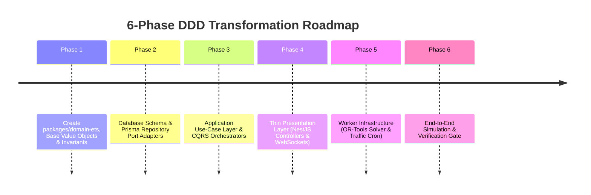

# 16 — DOMAIN-DRIVEN DESIGN (DDD) ARCHITECTURE & TRANSFORMATION PLAN

**Product:** AdhocX Direct Corporate Managed Transport (ETS)  
**Document:** Domain-Driven Design (DDD) Blueprint, Package Structure & Migration Strategy  
**Status:** Architectural Blueprint & Implementation Plan  
**Version:** 2.0 (Hyderabad Enterprise ETS Pilot)  
**Company:** Estemporaneo Technologies Private Limited  

---

> ### ⚠️ MANDATORY DESIGN & IMPLEMENTATION DIRECTIVE FOR ALL AI AGENTS & ENGINEERS
> Every AI agent, prompt, developer, and automated assistant modifying or contributing to this codebase **MUST STRICTLY ADHERE** to the project's foundational guidelines:
> 1. **Visual Foundation:** [`docs/04_DESIGN_SYSTEM.md`](file:///c:/Users/saavi/Desktop/adhocx/docs/04_DESIGN_SYSTEM.md) (Colors, Typography, Spacing, Tokens, Radius, Component Styling)
> 2. **Interaction & User Journey Rules:** [`docs/05_UI_UX_GUIDELINES.md`](file:///c:/Users/saavi/Desktop/adhocx/docs/05_UI_UX_GUIDELINES.md) (Information Architecture, Screen States, Error Handling, Navigation)
> 3. **Engineering Authority & Constraints:** [`docs/20_AI_AGENT_RULES.md`](file:///c:/Users/saavi/Desktop/adhocx/docs/20_AI_AGENT_RULES.md) (Correctness > Architecture > Security > Speed. Zero hallucinated business rules. Preserved integrity).

---

# 1. Architectural Philosophy: Hexagonal Clean DDD

To build a fault-tolerant, auditable enterprise transportation engine, AdhocX adopts a **Hexagonal (Ports & Adapters) Domain-Driven Design (DDD)** pattern.

### The Fundamental Rule:
> **The Domain Layer is Pure TypeScript.**  
> It has **zero dependencies** on NestJS, Express, Prisma, HTTP, or Redis. It encapsulates all business rules, mathematical constraints, state machines, and entity invariants. The API layer (`apps/api`) acts solely as a thin presentation and transport adapter.

```
┌────────────────────────────────────────────────────────────────────────────────────────┐
│                              INTERFACE / PRESENTATION LAYER                            │
│  (apps/api: NestJS REST Controllers, WebSocket Gateways, Validation Pipes, Swagger)    │
└───────────────────────────────────────────┬────────────────────────────────────────────┘
                                            │ DTOs (packages/contracts)
                                            ▼
┌────────────────────────────────────────────────────────────────────────────────────────┐
│                                APPLICATION / USE-CASE LAYER                            │
│  (apps/api/src/application: Orchestrators, Command Handlers, Event Listeners)          │
└─────────────────────┬─────────────────────────────────────────────┬────────────────────┘
                      │                                             │
                      ▼                                             ▼
┌───────────────────────────────────────────┐ ┌──────────────────────────────────────────┐
│         DOMAIN LAYER (CORE TRUTH)         │ │          INFRASTRUCTURE ADAPTERS         │
│           (packages/domain-ets)           │ │        (apps/api/src/infrastructure)     │
├───────────────────────────────────────────┤ ├──────────────────────────────────────────┤
│ • Aggregates & Entities                   │ │ • Prisma Repositories (Postgres PostGIS) │
│ • Value Objects (Money, H3, TimeWindow)   │ │ • Redis Geo & Redlock Adapters           │
│ • Domain Events & State Machines          │ │ • Google Maps Distance Matrix Client     │
│ • Domain Services & Business Invariants   │ │ • FCM Push & Gupshup SMS Gateway         │
│ • Repository & External Service Ports     │ │ • RazorpayX Bank Payout Adapter          │
└───────────────────────────────────────────┘ └──────────────────────────────────────────┘
```

---

# 2. Monorepo Package Topology

We structure the monorepo by placing the pure enterprise domains under `packages/domain-ets`:

```text
adhocx/
├── packages/
│   ├── contracts/             # Shared DTOs, Enums, Zod Schemas, API Request/Response types
│   ├── config/                # Shared Tailwind, ESLint, TypeScript compiler options
│   └── domain-ets/            # PURE DOMAIN-DRIVEN DESIGN PACKAGE (Zero framework dependencies)
│       ├── src/
│       │   ├── common/        # AggregateRoot, Entity, ValueObject, DomainEvent base classes
│       │   ├── value-objects/ # Money, GeoPoint, H3Index, TimeWindow, DwellBuffer, OtpCode
│       │   ├── demand/        # BOUNDED CONTEXT 1: Roster & Demand Generation
│       │   │   ├── entities/  # EmployeeCommuteProfile, ShiftSchedule
│       │   │   ├── aggregates/# RosterAggregate, TransportRequestAggregate
│       │   │   └── ports/     # ITransportRequestRepository, IGeocodingPort
│       │   ├── routing/       # BOUNDED CONTEXT 2: Route Optimization & Capacity
│       │   │   ├── aggregates/# RoutePlanAggregate, RouteStop
│       │   │   ├── invariants/# VehicleCapacityRule (Sedan 4 / SUV 6), MERTRule (<= 120m)
│       │   │   └── ports/     # IRoutingSolverPort, IRoutePlanRepository
│       │   ├── dispatch/      # BOUNDED CONTEXT 3: Autonomous H3 Allocation & Traffic Advancer
│       │   │   ├── aggregates/# DriverOfferAggregate, AllocationAttempt
│       │   │   ├── services/  # H3SpatialSearchService, DynamicTrafficAdvancerService
│       │   │   └── ports/     # ISpatialDriverIndexPort, ITrafficMatrixPort, IDriverOfferRepository
│       │   ├── execution/     # BOUNDED CONTEXT 4: Trip Execution & 5-Min No-Show Lifecycle
│       │   │   ├── aggregates/# TripAggregate, PassengerStopExecution
│       │   │   ├── invariants/# OtpVerificationRule, FiveMinuteDwellTimerRule
│       │   │   └── ports/     # ITripRepository, ITelemetryStreamPort
│       │   └── finance/       # BOUNDED CONTEXT 5: Dual-Ledger Financials
│       │       ├── aggregates/# CorporateBillableAggregate, DriverPayableAggregate
│       │       ├── services/  # RateCardCalculationService, PayoutBatchService
│       │       └── ports/     # ILedgerRepository, IBankPayoutGatewayPort
├── apps/
│   ├── api/                   # Thin NestJS Application Layer
│   │   ├── src/
│   │   │   ├── application/   # Use Case Handlers (e.g. ImportRosterUseCase, DispatchRouteUseCase)
│   │   │   ├── infrastructure/# Implementations of Domain Ports (Prisma, Redis, Google Maps)
│   │   │   ├── presentation/  # NestJS Controllers, Guards, Validation Pipes, WebSockets
│   │   │   └── workers/       # BullMQ Background Job Consumers (OR-Tools, Traffic Pollers)
│   ├── corporate/             # Corporate Client Portal (Next.js 14)
│   ├── admin/                 # Super Admin & Trips/Ride Management Panel (Next.js 14)
│   └── mobile/                # Flutter Apps (Driver & Employee)
```

---

# 3. The 5 Bounded Contexts & Core Invariants

### 3.1 Bounded Context 1: Roster & Demand Generation
- **Aggregate Root:** `TransportRequest`
- **Key Invariants:**
  - An employee cannot have duplicate requests for the same shift direction on the same date.
  - Pickup and dropoff coordinates must fall within the tenant's authorized PostGIS service zone polygon.
  - Idempotency hash uniqueness:
    $$\text{hash} = \text{SHA256}(\text{tenant\_id} + \text{employee\_id} + \text{date} + \text{shift\_time} + \text{direction})$$

### 3.2 Bounded Context 2: Route Planning & Capacity Optimization
- **Aggregate Root:** `RoutePlan` (contains ordered collection of `Route` and `RouteStop` entities).
- **Key Invariants:**
  - **Hard Capacity Rule:** A route assigned to a Sedan vehicle cannot exceed **4 passengers**; an SUV cannot exceed **6 passengers**.
  - **Dwell Time Buffer Rule:** Every residential pickup stop must include an immutable **5.0-minute dwell buffer**.
  - **Maximum Employee Ride Time (MERT):** No passenger's cumulative transit time may exceed **120 minutes**.
  - **Office Punctuality Invariant:** Final drop time at office $\le \text{Shift Login Time} - 10\text{ minutes}$.

### 3.3 Bounded Context 3: Autonomous Allocation & H3 Dispatch
- **Aggregate Root:** `DriverOffer`
- **Key Invariants:**
  - A driver can hold at most **one active offer** at any given moment.
  - **Offer Expiry Rule:** Offers expire strictly at $\text{SentAt} + 60\text{ seconds}$.
  - **Atomic Commit Invariant:** Once an offer is accepted, the route state transitions to `ASSIGNED` locked via Redis Redlock; all other pending offers are atomically withdrawn.
  - **Dynamic Traffic Advancer:** If traffic delay $\Delta t_{\text{traffic}} > 15\text{ mins}$, dispatch is advanced by $\Delta t_{\text{traffic}}$ to maintain arrival SLA.

### 3.4 Bounded Context 4: Trip Execution & Stop Lifecycle
- **Aggregate Root:** `Trip` (contains ordered collection of `PassengerStopExecution`).
- **Key Invariants:**
  - **Geofence Proximity:** Driver cannot trigger `"Arrived"` unless GPS distance to stop is $\le 100\text{ meters}$.
  - **Boarding OTP Verification:** Status cannot transition to `BOARDED` without validating the 4-digit cryptographic OTP against the employee's challenge token.
  - **5-Minute No-Show Lock:** Driver cannot transition passenger to `NO_SHOW` unless the dwell timer has elapsed $\ge 300\text{ seconds}$ at the geofence.

### 3.5 Bounded Context 5: Dual-Ledger Financials
- **Aggregates:** `CorporateBillable` and `DriverPayable`
- **Key Invariants:**
  - **Complete Isolation:** Corporate billables and driver payables are stored in separate, immutable ledger entities.
  - **Strict Integer Minor Units:** All monetary values (`Money` Value Object) are stored in **INR Paise**; zero floating-point operations.
  - **Idempotent Payouts:** Bank payout disbursements require a deterministic hash to prevent double-wire transfers.

---

# 4. Step-by-Step Codebase Transformation Strategy

We transform our existing repository into this DDD architecture in **6 sequential, non-breaking phases**:



### Phase 1: Package Creation & Domain Core (`packages/domain-ets`)
1. Create `packages/domain-ets` with `tsconfig.json` and zero external framework dependencies.
2. Implement fundamental Value Objects:
   - `Money` (integer paise math with addition, multiplication, formatting).
   - `GeoPoint` (latitude, longitude with WGS-84 validation).
   - `H3Index` (wrapper around `h3-js` for resolution 8/9 conversion and k-ring generation).
   - `TimeWindow` (start time, end time, duration checks).
   - `OtpCode` (4-digit numeric validation and time-based generation).
3. Implement Aggregates with strict internal state machines (`Trip`, `RoutePlan`, `TransportRequest`, `DriverOffer`).

### Phase 2: Prisma Schema Evolution & Mappers
1. Update `apps/api/prisma/schema.prisma` with corporate ETS entities (`tenants`, `offices`, `employees`, `rosters`, `transport_requests`, `routes`, `route_stops`, `corporate_invoices`, `driver_earnings`).
2. Run database migration `prisma migrate dev --name add_corporate_ets_domain`.
3. Build **Domain Mappers** (`PrismaTripMapper`, `PrismaRouteMapper`, `PrismaRosterMapper`) to translate database models to/from rich Domain Aggregates.

### Phase 3: Application Use-Case Layer (Hexagonal Ports & Adapters)
1. Define Application Use Cases under `apps/api/src/application/`:
   - `ImportRosterUseCase`
   - `OptimizeShiftRoutesUseCase`
   - `DispatchRouteWaveUseCase`
   - `VerifyBoardingOtpUseCase`
   - `MarkPassengerNoShowUseCase`
   - `CancelRideUseCase`
   - `ExecuteManualDispatchOverrideUseCase`
2. Implement Infrastructure Adapters under `apps/api/src/infrastructure/`:
   - `PrismaTripRepository` implementing `ITripRepository`.
   - `RedisSpatialDriverIndexAdapter` implementing `ISpatialDriverIndexPort`.
   - `GoogleMapsTrafficMatrixAdapter` implementing `ITrafficMatrixPort`.

### Phase 4: Refactor API Layer into Thin Controllers
1. NestJS Controllers in `apps/api/src/modules/` become 100% thin:
   - Inject use case handlers.
   - Validate HTTP request DTOs (`class-validator`).
   - Call `useCase.execute(command)`.
   - Return sanitized response DTOs.
2. WebSockets Gateway connects directly to domain event streams for real-time client broadcasting.

### Phase 5: Async Worker Queues (BullMQ)
1. Route optimization jobs are queued via BullMQ (`optimization-queue`).
2. A dedicated worker process executes the OR-Tools solver without blocking the NestJS event loop.
3. Traffic poller runs as a lightweight cron worker (`traffic-advancer-queue`) monitoring active routes.

### Phase 6: Automated Domain Testing & Simulation Verification
1. Author pure unit tests for domain invariants:
   - Capacity overflow rejected (5 passengers in a Sedan fails).
   - No-Show rejected if timer $< 300\text{ seconds}$.
   - Self-cancellation rejected if $< 9\text{ hours}$ before pickup.
2. Author end-to-end simulation tests verifying the complete flow from Excel upload to dual-ledger settlement.

---
*This blueprint establishes the architectural foundation for our implementation.*

