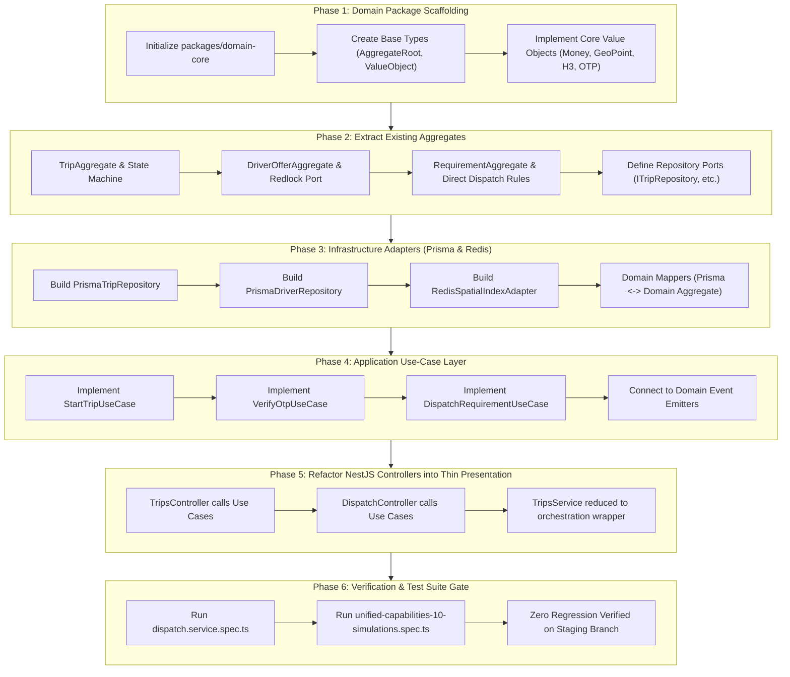

# 17 — CURRENT CODEBASE TO DOMAIN-DRIVEN DESIGN (DDD) TRANSFORMATION PLAN

**Product:** AdhocX Enterprise & Marketplace Platform  
**Document:** Master Engineering Transformation Plan: Modular Monolith to Domain-Driven Design (DDD)  
**Status:** Approved Architectural Blueprint  
**Version:** 2.0 (Staging Branch Baseline)  
**Company:** Estemporaneo Technologies Private Limited  

---

> ### ⚠️ MANDATORY BRANCHING & CI/CD DIRECTIVE
> 1. **Live Production Protection:** The production backend is active, operational, and serving live traffic on AWS EC2/ECS. **NO code modifications from this refactoring or enterprise build may be pushed directly to the `production` branch.**
> 2. **Dedicated Staging Isolation:** All work described in this document must be executed, committed, and tested exclusively on the **`staging`** branch.
> 3. **CI/CD Deployment Gate:** Production deployment workflows (`.github/workflows/production-deploy.yml`) are hard-locked to `branches: [production]`. Pushes to `staging` will never trigger live AWS production deployments.
> 4. **Mandatory UI/UX & Architecture Compliance:** Every AI agent, prompt, developer, and automated assistant modifying or contributing to this codebase **MUST STRICTLY ADHERE** to:
>    - [`docs/04_DESIGN_SYSTEM.md and apps/marketing/DESIGN_AND_UI.md`](file:///c:/Users/saavi/Desktop/adhocx/docs/04_DESIGN_SYSTEM.md)
>    - [`docs/05_UI_UX_GUIDELINES.md`](file:///c:/Users/saavi/Desktop/adhocx/docs/05_UI_UX_GUIDELINES.md)
>    - [`docs/20_AI_AGENT_RULES.md`](file:///c:/Users/saavi/Desktop/adhocx/docs/20_AI_AGENT_RULES.md)

---

# 1. Architectural Diagnosis: Current State vs. Target DDD State

### 1.1 Current Architecture: Modular Monolith with Anemic Domain Models
In `apps/api/src/modules/`:
* Modules (`trips`, `dispatch`, `requirements`, `drivers`, `settlements`) follow the **Transaction Script** pattern.
* Services (e.g., `trips.service.ts` at 1,364 lines) inject Prisma `DatabaseService` (`this.db`) directly.
* Business rules, SQL queries, external notifications, and data formatting are tightly coupled within procedural methods.
* **The Problem:** As we introduce Corporate ETS (complex multi-stop routes, Google OR-Tools, 5-minute dwell timers, 9-hour cancellation policies, dual ledgers), procedural services will explode in complexity, leading to race conditions, regression bugs, and untestable code.

### 1.2 Target Architecture: Hexagonal Domain-Driven Design (Ports & Adapters)

```
┌────────────────────────────────────────────────────────────────────────────────────────┐
│                              INTERFACE / PRESENTATION LAYER                            │
│  apps/api/src/presentation/ (Controllers, WebSocket Gateways, Pipes, Guards, Swagger)  │
│  • Pure HTTP/WSS routing. Validates input DTOs. Zero business rules.                   │
└───────────────────────────────────────────┬────────────────────────────────────────────┘
                                            │ DTOs (packages/contracts)
                                            ▼
┌────────────────────────────────────────────────────────────────────────────────────────┐
│                                APPLICATION / USE-CASE LAYER                            │
│  apps/api/src/application/ (Command Handlers, Query Handlers, Event Orchestrators)     │
│  • StartTripUseCase, VerifyBoardingOtpUseCase, DispatchRouteWaveUseCase                │
└─────────────────────┬─────────────────────────────────────────────┬────────────────────┘
                      │                                             │
                      ▼                                             ▼
┌───────────────────────────────────────────┐ ┌──────────────────────────────────────────┐
│         DOMAIN LAYER (CORE TRUTH)         │ │          INFRASTRUCTURE ADAPTERS         │
│           (packages/domain-core)          │ │        (apps/api/src/infrastructure)     │
├───────────────────────────────────────────┤ ├──────────────────────────────────────────┤
│ 100% PURE TYPESCRIPT (ZERO FRAMEWORK DEPS)│ │ • Prisma Repositories (Postgres PostGIS) │
│ • Aggregates & Entities with Invariants   │ │ • Redis Geo & Redlock Mutex Adapters     │
│ • Value Objects (Money, H3, TimeWindow)   │ │ • Google Maps Distance Matrix Client     │
│ • Domain Events & State Machines          │ │ • FCM Push & Gupshup SMS Gateway         │
│ • Repository Ports (Interfaces)           │ │ • RazorpayX Payout Gateway               │
└───────────────────────────────────────────┘ └──────────────────────────────────────────┘
```

---

# 2. Monorepo Package Architecture

To cleanly enforce DDD across the monorepo, we establish a dedicated domain package: **`packages/domain-core`**:

```text
adhocx/
├── packages/
│   ├── contracts/             # Shared DTOs, Enums, Zod Schemas, API Request/Response
│   ├── config/                # Shared ESLint, Prettier, Tailwind configurations
│   └── domain-core/           # PURE DOMAIN-DRIVEN DESIGN PACKAGE (Zero framework dependencies)
│       ├── package.json
│       ├── tsconfig.json
│       └── src/
│           ├── common/        # AggregateRoot, Entity, ValueObject, DomainEvent base types
│           ├── value-objects/ # Money, GeoPoint, H3Index, TimeWindow, OtpCode, DwellBuffer
│           ├── fleet/         # Bounded Context: Driver & Vehicle Compliance
│           ├── marketplace/   # Bounded Context: Direct Demand Requirements
│           ├── dispatch/      # Bounded Context: H3 Proximity & Allocation
│           ├── trip/          # Bounded Context: Trip Execution & Stop Lifecycle
│           ├── corporate/     # Bounded Context: Corporate Roster & Commute Demand
│           └── finance/       # Bounded Context: Dual Ledgers, Payouts & Invoicing
├── apps/
│   ├── api/                   # Thin NestJS Application Layer
│   │   ├── src/
│   │   │   ├── application/   # Use Case Handlers (Commands & Queries)
│   │   │   ├── infrastructure/# Prisma Repository Adapters, Redis, Google Maps
│   │   │   ├── presentation/  # NestJS Controllers, Guards, Validation Pipes, WebSockets
│   │   │   └── workers/       # BullMQ Background Job Consumers (OR-Tools, Traffic Pollers)
│   ├── corporate/             # Corporate Client Portal (Next.js 14)
│   ├── admin/                 # Super Admin & Trips/Ride Management Panel (Next.js 14)
│   └── mobile/                # Flutter Apps (Driver & Employee)
```

---

# 3. Domain Extraction Matrix: Mapping Existing Modules to Bounded Contexts

| Existing Module (`apps/api/src/modules/`) | Target Bounded Context (`packages/domain-core/`) | Domain Aggregates & Entities | Core Invariants & Rules |
| :--- | :--- | :--- | :--- |
| `trips`, `locations`, `reviews` | **Trip Execution Context** (`/trip`) | `TripAggregate`, `TripStop`, `TripEvent` | • Strict state transitions (`validateTripTransition`).<br>• Cannot start trip without valid OTP.<br>• Cannot complete trip without minimum distance.<br>• GPS pings throttled to 15–30s. |
| `dispatch`, `offers`, `assignments` | **Dispatch & Allocation Context** (`/dispatch`) | `DriverOfferAggregate`, `DispatchWave`, `H3GridIndex` | • Driver can hold only 1 active offer.<br>• 60-second offer expiry.<br>• Atomic reservation via Redlock.<br>• Radial H3 expansion: 5 km $\to$ 10 km. |
| `requirements` | **Marketplace Demand Context** (`/marketplace`) | `RequirementAggregate` | • Direct Dispatch sequential wave state machines.<br>• Vehicle class & capacity constraints.<br>• Expiry before pickup time. |
| `drivers`, `vehicles` | **Fleet & Compliance Context** (`/fleet`) | `DriverAggregate`, `VehicleAggregate`, `ComplianceCheck` | • Unverified drivers cannot receive dispatches.<br>• Document expiration checks (RC, DL, Insurance).<br>• Duty hour limits. |
| `ledger`, `settlements`, `payments`, `pricing` | **Finance & Settlement Context** (`/finance`) | `LedgerAccount`, `SettlementBatch`, `Money` (Paise) | • Zero floating-point math (Integer minor units).<br>• Immutable append-only ledger entries.<br>• Idempotent bank payout hashing. |
| *New Corporate ETS* (`rosters`, `corporate-routes`) | **Corporate Managed Commute Context** (`/corporate`) | `RosterAggregate`, `TransportRequest`, `RoutePlan`, `RouteStop` | • Sedan (4) / SUV (6) hard capacity.<br>• 5-minute dwell buffer per pickup.<br>• 9-hour self-cancellation cutoff.<br>• Dynamic Traffic Advancer (DDA). |

---

# 4. Detailed 6-Phase Transformation Execution Plan



---

## Phase 1: Domain Core Scaffolding (`packages/domain-core`)

### 1.1 Package Setup
* Create `packages/domain-core/package.json` with workspace name `@adhocx/domain-core`.
* Configure `tsconfig.json` with strict mode (`strict: true`, `noImplicitAny: true`).
* Update root `pnpm-workspace.yaml` to include `packages/domain-core`.

### 1.2 Base Domain Primitives (`src/common/`)
* **`ValueObject<T>`**: Immutable value object base class with structural equality checks.
* **`Entity<T>`**: Base entity class with UUID identity.
* **`AggregateRoot<T>`**: Extends `Entity`, records internal domain events (`addDomainEvent()`, `clearDomainEvents()`).
* **`DomainEvent`**: Base interface with `eventId`, `occurredOn`, and `aggregateId`.

### 1.3 Core Value Objects (`src/value-objects/`)
1. **`Money`**:
   - Stores integer minor units (`paise: bigint | number`).
   - Methods: `add(other)`, `subtract(other)`, `multiply(factor)`, `formatINR()`.
   - Prevents all binary floating-point rounding errors (`0.1 + 0.2 != 0.3`).
2. **`GeoPoint`**:
   - Latitude $[-90, 90]$, Longitude $[-180, 180]$.
   - Haversine distance calculation: `distanceToMeters(other: GeoPoint): number`.
3. **`H3Index`**:
   - Wraps `h3-js`. Converts lat/lon to H3 Resolution 8/9 cells.
   - Computes $k$-ring sets for 5 km ($k=6$) and 10 km ($k=12$) radius searches.
4. **`OtpCode`**:
   - 4-digit or 6-digit numeric string. Cryptographic generation and validation.
5. **`DwellBuffer`**:
   - Dwell duration in seconds (defaults to **300 seconds / 5.0 minutes**).
   - Method: `isExpired(elapsedSeconds: number): boolean`.

---

## Phase 2: Domain Aggregates & Invariants Extraction

Extract existing business logic from `trips.service.ts`, `dispatch.service.ts`, and `requirements.service.ts` into pure domain aggregates:

### 2.1 `TripAggregate` (`src/trip/aggregates/trip.aggregate.ts`)
```typescript
export class TripAggregate extends AggregateRoot<string> {
  private _status: TripStatus;
  private _startOtp: OtpCode;
  private _endOtp?: OtpCode;
  private _actualDistanceMeters: number = 0;
  private _driverId: string;
  private _vehicleId: string;

  // Invariant: Trip can only start if valid OTP is presented
  public startTrip(inputOtp: string, currentCoord: GeoPoint): Result<void> {
    if (this._status !== TripStatus.ASSIGNED && this._status !== TripStatus.DRIVER_ARRIVED) {
      return Result.fail(`Cannot start trip in status ${this._status}`);
    }
    if (!this._startOtp.validate(inputOtp)) {
      return Result.fail('Invalid boarding OTP');
    }
    this._status = TripStatus.IN_PROGRESS;
    this.addDomainEvent(new TripStartedDomainEvent(this.id, this._driverId, currentCoord));
    return Result.ok();
  }

  // Invariant: Cannot complete trip without reaching minimum trip distance
  public completeTrip(endCoord: GeoPoint, tollAmount?: Money): Result<void> {
    if (this._status !== TripStatus.IN_PROGRESS) {
      return Result.fail(`Cannot complete trip in status ${this._status}`);
    }
    this._status = TripStatus.COMPLETED;
    this.addDomainEvent(new TripCompletedDomainEvent(this.id, this._actualDistanceMeters, tollAmount));
    return Result.ok();
  }
}
```

### 2.2 `DriverOfferAggregate` (`src/dispatch/aggregates/driver-offer.aggregate.ts`)
* Invariant: Driver offer expires after 60 seconds (`isExpired()`).
* Invariant: Offer acceptance requires atomic status transition (`SENT` $\to$ `ACCEPTED`).

### 2.3 Repository Ports (`src/*/ports/`)
Define interfaces independent of Prisma:
* `ITripRepository`: `findById(id: string)`, `save(trip: TripAggregate)`, `findByDriver(driverId: string)`.
* `IDriverRepository`: `findAvailableInH3Grid(h3Cells: string[])`, `updateAvailability(driverId: string, status: DriverAvailability)`.
* `IRequirementRepository`: `findById(id: string)`, `save(req: RequirementAggregate)`.

---

## Phase 3: Infrastructure Adapters (Prisma & Redis)

Implement repository ports inside `apps/api/src/infrastructure/`:

### 3.1 Domain Mappers
Create bidirectional mappers:
* `PrismaTripMapper.toDomain(rawPrismaTrip): TripAggregate`
* `PrismaTripMapper.toPersistence(tripAggregate): Prisma.TripCreateInput`

### 3.2 Prisma Repository Implementations
```typescript
@Injectable()
export class PrismaTripRepository implements ITripRepository {
  constructor(private readonly prisma: DatabaseService) {}

  async findById(id: string): Promise<TripAggregate | null> {
    const raw = await this.prisma.trip.findUnique({
      where: { id },
      include: { events: true, requirement: true }
    });
    return raw ? PrismaTripMapper.toDomain(raw) : null;
  }

  async save(aggregate: TripAggregate): Promise<void> {
    const data = PrismaTripMapper.toPersistence(aggregate);
    await this.prisma.$transaction(async (tx) => {
      await tx.trip.upsert({ where: { id: aggregate.id }, update: data, create: data });
      // Dispatch domain events
      await this.domainEventDispatcher.dispatchAll(aggregate.clearDomainEvents());
    });
  }
}
```

---

## Phase 4: Application Use-Case Layer

Create single-responsibility use cases in `apps/api/src/application/`:

1. **`StartTripUseCase`**:
   - Loads `TripAggregate` from `ITripRepository`.
   - Calls `trip.startTrip(dto.otp, dto.currentCoord)`.
   - Persists via `ITripRepository.save(trip)`.
   - Emits WebSocket event and push notifications via ports.
2. **`VerifyBoardingOtpUseCase`** (Corporate ETS):
   - Validates passenger OTP at pickup stop.
   - Enforces stop sequence invariant.
3. **`MarkPassengerNoShowUseCase`** (Corporate ETS):
   - Verifies 300-second dwell buffer invariant.
   - Marks passenger `NO_SHOW` and advances route.

---

## Phase 5: Refactoring Controllers to Thin Presentation

`apps/api/src/modules/trips/trips.controller.ts` is transformed:
* Before: Calls monolithic `this.tripsService.startTrip(...)` with direct SQL and side-effects.
* After:
```typescript
@Post(':id/start')
async startTrip(
  @Param('id') id: string,
  @Body() dto: StartTripDto,
  @CurrentUser() user: AuthUser
): Promise<TripResponseDto> {
  const result = await this.startTripUseCase.execute({
    tripId: id,
    otp: dto.startOtp,
    userId: user.id,
    userRole: user.role,
    latitude: dto.latitude,
    longitude: dto.longitude
  });
  if (result.isFailure) {
    throw new BadRequestException(result.error);
  }
  return result.getValue();
}
```

---

## Phase 6: Automated Verification & Regression Gate

Before merging or advancing, the entire existing test suite must pass without regression:
1. **Unit Test Gate:** All new domain aggregates and value objects achieve $> 95\%$ unit test coverage.
2. **Dispatch Spec Test:** Run `apps/api/test/dispatch.service.spec.ts`.
3. **Simulation Suite:** Run `apps/api/test/unified-capabilities-10-simulations.spec.ts`.
4. **Prisma Schema Intactness:** Database migrations apply cleanly on PostgreSQL 16.

---

# 5. Foundation for the New Corporate ETS Software

Once this DDD transformation is established:
1. **Corporate Roster Ingestion** plugs cleanly into `packages/domain-core/src/corporate/` as `RosterAggregate`.
2. **OR-Tools CVRPTW Solver** is implemented as an infrastructure adapter implementing `IRoutingSolverPort`.
3. **Dynamic Traffic Advancer** is implemented as a domain service using `ITrafficMatrixPort`.
4. **5-Minute Stop Dwell Timer & OTP Boarding** are native methods on `RouteStopAggregate`.
5. **Dual-Ledger Billing & Payouts** are implemented as immutable domain entities using `Money` value objects.

---
*Proceed to Step 1: Branch verification and scaffolding `packages/domain-core`.*

